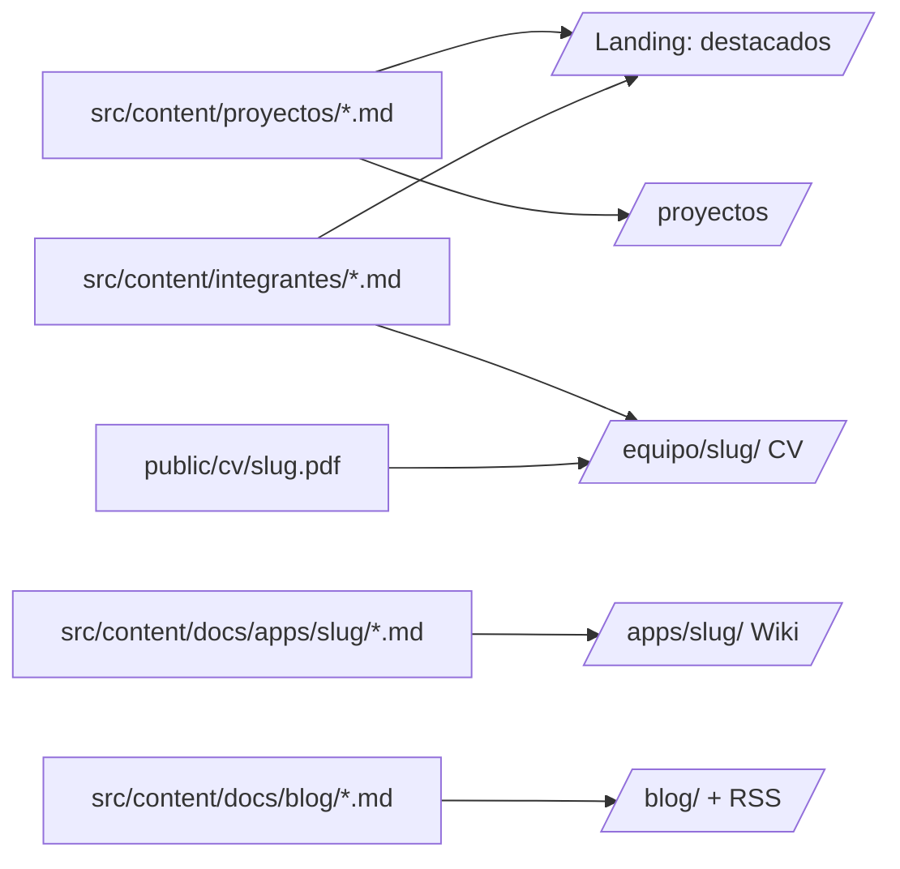
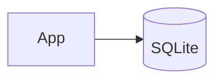

# Cómo contribuir — agregar o actualizar contenido del sitio

Paso a paso para cada tipo de contenido. Para entender el _porqué_ de cada cosa, ver las guías en [docs/guias/](guias/).

> **Estado:** lo marcado con 🚧 depende del blog (US-505, v1.1.0), que todavía no está hecho.

## 0. Mapa del sitio: qué archivo alimenta cada página



| Quiero...                            | Toco                                      | Sección |
| ------------------------------------ | ----------------------------------------- | ------- |
| Sumar o actualizar un proyecto       | `src/content/proyectos/<slug>.md`         | 2       |
| Sumar o editar un integrante / su CV | `src/content/integrantes/<slug>.md`       | 3       |
| Documentar una app en la wiki        | `src/content/docs/apps/<slug>/`           | 4       |
| Publicar un post o un release 🚧     | `src/content/docs/blog/<fecha>-<slug>.md` | 5       |
| Cambiar textos de la landing         | `src/pages/index.astro`                   | 6       |
| Cambiar la imagen al compartir       | `public/og.png` (1200×630)                | 7       |

## 1. Flujo común (siempre)

```bash
git checkout develop && git pull
git checkout -b docs/<app>-<tema>      # o feature/<algo>, fix/<algo>
# ... cambios ...
npm run dev                            # mirar en http://localhost:4321/porfolio_stack-dos/
npm run build                          # tiene que terminar sin errores
git add . && git commit -m "docs: ..." # Conventional Commits
git push -u origin <rama>
```

Después abrí un PR a `develop` y completá el checklist. El otro integrante lo revisa. **El sitio no cambia hasta el release** (`develop` → `main`, sección 8).

Reglas para todo el contenido:

- **Slugs** (nombres de archivo) en kebab-case, sin tildes ni eñes: `nicolas-pinera.md`, `stat-pro`.
- **Links internos** con la base: `/porfolio_stack-dos/apps/stat-pro/`. Si falta la base, el build falla.
- Toda página con `title` y `description`. La `description` es el texto que aparece al compartir el link.
- Imágenes con texto alternativo: ``.

## 2. Proyecto

Archivo: `src/content/proyectos/<slug>.md`. Se muestra en `/proyectos/` y, si es `destacado`, en la landing.

```md
---
nombre: VIN Decoder
descripcion: Decodifica el número de chasis de un vehículo.
stack: [TypeScript, React]
estado: planificado # planificado | en-desarrollo | publicado | archivado
repo: https://github.com/stack-dos/vin-decoder # opcional
wiki: /apps/vin-decoder/ # opcional, solo si existe la wiki
destacado: false # opcional (default false)
---
```

- Los campos y sus reglas están en `src/content.config.ts` (guía 02). Si algo está mal, el build lo dice.
- Cuando el proyecto cambia de etapa, actualizá `estado`. Si le hiciste wiki, agregá `wiki`.
- No borres proyectos viejos: usá `estado: archivado`.

## 3. Integrante y CV

Archivo: `src/content/integrantes/<slug>.md`. Se muestra como tarjeta en la landing y como CV en `/equipo/<slug>/`.

```md
---
nombre: Nicolas Piñera
rol: Estudiante de Ingeniería en Computación, desarrollador
foto: ./fotos/nicolas-pinera.jpg # opcional por ahora
email: ...
linkedin: https://linkedin.com/in/<usuario>
github: https://github.com/<usuario>
cv_pdf: /cv/nicolas-pinera.pdf # opcional
---

## Experiencia

...

## Formación

...

## Skills

...
```

- **El cuerpo es el CV.** Se escribe en Markdown, con títulos `##`.
- **Foto:** va en `src/content/integrantes/fotos/<slug>.jpg`, cuadrada, idealmente de 400×400 o más. Astro la optimiza; no hace falta achicarla. La ruta en el frontmatter es relativa al `.md`.
- **CV en PDF:** va en `public/cv/<slug>.pdf`. En el frontmatter se escribe `/cv/<slug>.pdf`, sin la base (la agrega la página). Alternativa: desde `/equipo/<slug>/`, "Imprimir → Guardar como PDF" (ADR-007).
- **Integrante nuevo:** creá el archivo y listo. La tarjeta y su página de CV se generan solas.

## 4. Wiki de una app

Carpeta: `src/content/docs/apps/<slug>/`. Aparece en el sidebar y en el buscador sin configurar nada.

```txt
apps/<slug>/
├── index.md          # qué es, estado, links (repo, proyecto)
├── instalacion.md
├── arquitectura.md   # con diagramas Mermaid
└── uso.md            # con capturas
```

Cada página:

````md
---
title: Arquitectura
description: Cómo está armado Stat Pro por dentro.
sidebar:
  order: 3 # orden dentro de la sección (opcional)
---

## Componentes




````

Herramientas disponibles (guía 04):

- **Diagramas:** bloques ` ```mermaid `. Se pueden probar antes en <https://mermaid.live>.
- **Capturas:** van junto a los `.md`, por ejemplo en `apps/<slug>/capturas/`. Se amplían con un clic.
- **Avisos:**

  ```md
  :::caution[En desarrollo]
  Esta sección puede cambiar.
  :::
  ```

  Los tipos son `note`, `tip`, `caution` y `danger`.

**Qué NO publicar** (ADR-005): guías internas, archivos de contexto de IA (`CLAUDE.md`, prompts), credenciales, `.env`, datos personales de terceros.

**App nueva, checklist:**

1. Copiar la plantilla (`docs/plantilla-app/`, sin su README) a `src/content/docs/apps/<slug>/`.
2. Reemplazar `SLUG` y todo lo que dice `COMPLETAR`. Antes del PR, `grep -rn "COMPLETAR|SLUG" src/content/docs/apps/<slug>/` no tiene que devolver nada.
3. Cargar o actualizar el proyecto en `src/content/proyectos/<slug>.md`, con `wiki: /apps/<slug>/`.
4. Si querés que aparezca en el header, sumarla en `src/components/NavLinks.astro` (hoy "Wiki" apunta a Stat Pro).
5. Es un **MINOR** del sitio (sección 8).

**Al cerrar cada versión de la app** (ej. Stat Pro v0.1): quien cerró la versión abre un PR en este repo que actualiza la wiki (estado del aviso en `index.md`, roadmap, comandos nuevos en `uso.md`) y el otro integrante lo revisa antes de aprobar. Desde la v1.1.0 del sitio, además se publica el post del release (sección 5).

## 5. Post del blog 🚧

Depende de la US-505 (`starlight-blog`, ADR-008, versión v1.1.0 del sitio).

Archivo: `src/content/docs/blog/<AAAA-MM-DD>-<slug>.md`.

```md
---
title: Stat Pro v0.2 — Carga de partidos en vivo
date: 2026-11-03
authors: nicolas-pinera
tags: [stat-pro, release]
excerpt: Ya se pueden cargar estadísticas durante el partido.
---

## Qué cambió

- ...

Más detalles en la [wiki](/porfolio_stack-dos/apps/stat-pro/).
```

- **Release de una app:** título `<Proyecto> vX.Y — <resumen>`, tags `[<slug-proyecto>, release]`. El cuerpo resume qué cambió y linkea a la wiki.
- **Post de avance**, sin versión: solo el tag del proyecto, o ninguno si es del equipo.
- Aparece solo en `/blog/`, en la página de su tag y en el RSS.

## 6. Landing

La landing (`src/pages/index.astro`, US-401) **no tiene datos hardcodeados**:

- Las tarjetas del equipo salen de `integrantes`.
- Los proyectos destacados salen de `proyectos` con `destacado: true`.

Para cambiar algo de ahí, editá esas colecciones (secciones 2 y 3). Solo los textos fijos ("Qué hacemos", "Cómo trabajamos", "Contacto") se editan directamente en `index.astro`.

## 7. Imagen para compartir

`public/og.png` es la imagen que se ve al pegar el link en WhatsApp o LinkedIn. Se reemplaza por otra de **1200×630 px**, con el mismo nombre. Después del deploy, refrescala en <https://www.linkedin.com/post-inspector/>.

## 8. Publicar (release del sitio)

1. Con todo mergeado en `develop`, abrir un PR `develop` → `main`.
2. Al mergear, GitHub Actions publica el sitio (`.github/workflows/deploy.yml`, guía 05).
3. Crear el tag y el release en GitHub según SemVer:

   | Cambio                                    | Versión          |
   | ----------------------------------------- | ---------------- |
   | Corrección de textos o estilos            | PATCH (`v1.0.1`) |
   | Sección nueva o app nueva en la wiki      | MINOR (`v1.1.0`) |
   | Cambio de URLs que rompe links existentes | MAJOR (`v2.0.0`) |

4. Revisar el sitio publicado: links del header, la página nueva y, en el celular, el modo claro/oscuro.

## 9. Si algo falla

| Síntoma en `npm run build`                           | Qué hacer                                                        |
| ---------------------------------------------------- | ---------------------------------------------------------------- |
| `InvalidContentEntryDataError ... <campo>: Required` | Falta ese campo en el frontmatter del archivo indicado           |
| `Invalid option: expected one of ...`                | Valor fuera de la lista (ej. `estado`): usar uno de los listados |
| `Invalid URL` / `Invalid email`                      | Revisar el formato (`https://...`)                               |
| `invalid link`                                       | Falta la base `/porfolio_stack-dos` o la página no existe        |
| `invalid link to custom page`                        | Agregar la ruta a `exclude` del validador (guía 04)              |
| Página nueva que no aparece en el sidebar            | ¿Tiene `title`? ¿Está dentro de `src/content/docs/`?             |
| Cambios de esquema que el editor no reconoce         | Reiniciar `npm run dev` / "TypeScript: Restart TS Server"        |
