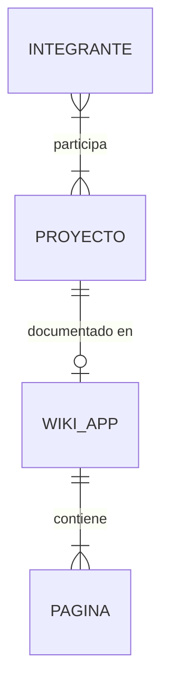
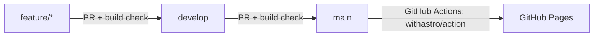

# PRD — Portfolio + Wiki Stack-dos

## 1. Descripción del producto

### 1.1 Visión

Un sitio estático, publicado en GitHub Pages desde el repo `Stack-dos/porfolio_stack-dos`, que cumple dos funciones:

- **Portfolio del equipo:** quiénes somos y qué proyectos armamos.
- **Wiki de aplicaciones:** documentación de cada app que vaya creando el equipo.

### 1.2 Problema que resuelve

| Problema                                                             | Impacto                                                                          |
| -------------------------------------------------------------------- | -------------------------------------------------------------------------------- |
| El repo quedó con la documentación de un proyecto anterior           | El repo no refleja su propósito actual y confunde a quien entra                  |
| No hay un lugar público donde mostrar los proyectos del equipo       | Los proyectos no tienen visibilidad hacia afuera                                 |
| La documentación de cada app queda dispersa o directamente no existe | Cuesta retomar o compartir una app                                               |
| No hay un flujo definido para agregar contenido y publicarlo         | Cada cambio implica pasos manuales y es fácil que la página quede desactualizada |

### 1.3 Alcance

El trabajo se divide en dos fases:

1. **Limpieza:** archivar el contenido viejo en el tag `legacy-estadisticas` y sacarlo de `develop`.
2. **Construcción del sitio:** Astro + Starlight, configuración de GitHub Pages, CI/CD con GitHub Actions y un flujo simple para sumar apps a la wiki.

El portfolio es del equipo, pero incluye un perfil/CV por integrante (hoy somos dos).

## 2. Perfiles de usuario

Proyecto **real / profesional**: lo que se publica representa al equipo, así que los estándares y el versionado son estrictos.

| Perfil                           | Qué busca                                      | Qué necesita del sitio                                                        |
| -------------------------------- | ---------------------------------------------- | ----------------------------------------------------------------------------- |
| Reclutadores / empresas          | Evaluar las capacidades del equipo             | Una landing clara, proyectos destacados con stack y resultados, y un contacto |
| Clientes potenciales             | Saber si el equipo puede resolver su necesidad | Casos de proyectos, servicios y contacto visible                              |
| Otros desarrolladores            | Usar o entender las apps del equipo            | Una wiki por app: instalación, arquitectura y uso, con buscador               |
| Integrantes del equipo (autores) | Documentar y consultar sus apps                | Agregar o editar contenido en Markdown vía PR, publicado al hacer el release  |

**Autoría:** todos los integrantes pueden escribir en la wiki. Los cambios entran por PR a `develop` con revisión, y se publican con el PR de release a `main` (ADR-006).

## 3. Requerimientos no funcionales

| Categoría      | Requerimiento                                | Métrica / criterio                                                                                      |
| -------------- | -------------------------------------------- | ------------------------------------------------------------------------------------------------------- |
| Rendimiento    | El sitio carga rápido en mobile y desktop    | Lighthouse ≥ 90 en Performance                                                                          |
| Accesibilidad  | Navegable con teclado y lectores de pantalla | WCAG 2.1 AA, Lighthouse ≥ 90 en Accessibility                                                           |
| SEO            | Indexable y compartible                      | Lighthouse ≥ 90 en SEO, metadatos OG por página                                                         |
| Idioma         | Contenido en español                         | Inglés previsto a futuro: la estructura no debe impedir agregar i18n (Starlight lo soporta nativamente) |
| Hosting        | GitHub Pages, sin costo                      | URL: `https://stack-dos.github.io/porfolio_stack-dos/` (no hay dominio propio)                          |
| Despliegue     | Publicación automática                       | Merge del PR de release a `main` → sitio actualizado sin pasos manuales                                 |
| Calidad        | Ningún cambio roto llega a producción        | Build obligatorio en cada PR, que bloquea el merge si falla                                             |
| Mantenibilidad | Sumar contenido sin saber Astro              | Una app nueva = una carpeta con archivos Markdown                                                       |

## 4. Arquitectura de datos (modelo de contenido)

El sitio no tiene base de datos: el contenido son archivos versionados en el repo y validados con _content collections_ de Astro (esquema Zod).

### 4.1 Colección `proyectos` (portfolio)

Un archivo por proyecto en `src/content/proyectos/<slug>.md`:

```yaml
nombre: Stat Pro
descripcion: App de estadísticas de básquet
stack: [...]
estado: en-desarrollo # planificado | en-desarrollo | publicado | archivado
repo: https://github.com/Stack-dos/...
wiki: /apps/stat-pro/ # opcional
destacado: true
```

### 4.2 Colección `integrantes` (equipo y CV)

Un archivo por persona en `src/content/integrantes/<slug>.md`. El cuerpo en Markdown es el CV: experiencia, formación y skills.

```yaml
nombre: ...
rol: ...
foto: ./fotos/<slug>.jpg
email: ...
linkedin: https://linkedin.com/in/...
github: https://github.com/...
cv_pdf: /cv/<slug>.pdf # opcional, descargable
```

### 4.3 Wiki (Starlight)

Una carpeta por app en `src/content/docs/apps/<slug>/`:

```txt
apps/<slug>/
├── index.md          # qué es, estado, links
├── instalacion.md
├── arquitectura.md
└── uso.md
```

### 4.4 Contenido inicial

| Proyecto    | Estado        | Wiki al lanzar                                              |
| ----------- | ------------- | ----------------------------------------------------------- |
| Stat Pro    | en-desarrollo | Sí, armada a mano desde el repo `app_estadistica` (ADR-005) |
| VIN Decoder | planificado   | No                                                          |

Relaciones: cada proyecto puede tener cero o una wiki, y cada integrante participa en uno o más proyectos.



## 5. Arquitectura de software

- **Framework:** Astro + integración Starlight.
- **Rutas:** `/` (landing / quiénes somos), `/equipo/<slug>/` (CV de cada integrante), `/proyectos/` (listado generado desde la colección) y `/apps/<slug>/...` (wiki con sidebar y buscador Pagefind).
- **Base path:** `site: https://stack-dos.github.io`, `base: /porfolio_stack-dos`.

### 5.1 Ramas y despliegue

Se mantiene la estructura `develop` → `main`:

- Cada feature o contenido sale en una rama propia y entra a `develop` por PR, con el build como check obligatorio.
- El sitio se despliega cuando `develop` se mergea a `main`.
- Un hotfix sale de `main` y vuelve a `main` y a `develop`.
- `develop` y `main` están protegidas: sin push directo y con el check de build obligatorio.



### 5.2 Contacto

- Por integrante: mail, LinkedIn y GitHub personal, en la tarjeta de la landing y en su página de CV.
- Del equipo: GitHub de la organización (`Stack-dos`), en el header/footer.

### 5.3 Integrantes iniciales

| Integrante       | Rol                                                    |
| ---------------- | ------------------------------------------------------ |
| Nicolas Piñera   | Estudiante de Ingeniería en Computación, desarrollador |
| Marcos Battigane | Estudiante de Ingeniería en Sistemas, desarrollador    |

## 6. Estándares de desarrollo

- **Commits:** Conventional Commits (`feat:`, `fix:`, `docs:`, `chore:`, `ci:`).
- **Ramas:** `feature/<descripcion>`, `docs/<app>-<tema>` y `fix/<descripcion>`, siempre desde `develop`.
- **PR:** todo cambio entra por PR, con al menos 1 aprobación del otro integrante y el build de CI en verde.
- **Contenido:** archivos en español, slugs en kebab-case sin tildes (`stat-pro`, `nicolas-pinera`).
- **Código:** TypeScript estricto (`astro/tsconfigs/strict`) y formato con Prettier (plugin de Astro).
- **Node:** versión fijada en `.nvmrc` (LTS) y usada por CI.

## 7. Decisiones de arquitectura (ADRs)

Las decisiones se registran en `docs/adr/` (fuente única, plantilla en `docs/adr/template_adr.md`):

| ADR                                                        | Decisión                                                                     |
| ---------------------------------------------------------- | ---------------------------------------------------------------------------- |
| [ADR-001](adr/ADR-001-stack-del-sitio.md)                  | Astro + Starlight                                                            |
| [ADR-002](adr/ADR-002-metodo-de-deploy.md)                 | GitHub Actions + Pages oficial (`withastro/action` + `actions/deploy-pages`) |
| [ADR-003](adr/ADR-003-contenido-en-el-repo.md)             | Contenido en Markdown en el repo (content collections)                       |
| [ADR-004](adr/ADR-004-archivado-contenido-viejo.md)        | Tag `legacy-estadisticas` y borrar el contenido viejo de `develop`           |
| [ADR-005](adr/ADR-005-documentacion-de-apps-en-la-wiki.md) | La wiki de cada app se arma a mano a partir de la documentación de su repo   |
| [ADR-006](adr/ADR-006-estrategia-de-ramas.md)              | `feature/*` → `develop` → `main`, con hotfix desde `main`                    |
| [ADR-007](adr/ADR-007-formato-del-cv.md)                   | CV web y PDF opcional hecho a mano, con estilos de impresión                 |
| [ADR-008](adr/ADR-008-blog.md)                             | Blog de novedades con el plugin `starlight-blog`                             |

## 8. Métricas de éxito

| Métrica                                    | Objetivo                                            |
| ------------------------------------------ | --------------------------------------------------- |
| Lighthouse (4 categorías)                  | ≥ 90                                                |
| Tiempo de merge a `main` → sitio publicado | < 5 min                                             |
| Pasos para sumar una app a la wiki         | Copiar la plantilla y abrir un PR, sin tocar código |
| Builds rotos en `main`                     | 0 (bloqueados por CI en el PR)                      |

## 9. Riesgos

| Riesgo                                      | Mitigación                                                                    |
| ------------------------------------------- | ----------------------------------------------------------------------------- |
| Links rotos por el `base` path de Pages     | Usar siempre `import.meta.env.BASE_URL` o los helpers de Astro; validar en CI |
| La wiki se desactualiza respecto a cada app | Checklist de PR que incluye "¿actualizaste la wiki?" en los repos de las apps |
| Exponer datos personales (mail) a scrapers  | Mostrar el mail con `mailto:` y evaluar ofuscación simple si llega spam       |

## 10. Hitos, épicas e historias de usuario

### Hito 1 — Limpieza del repositorio

**Épica:** dejar el repo listo para su nuevo propósito, sin perder lo anterior.

#### US-101: Archivar el proyecto anterior

- **Esfuerzo:** S · **Prioridad:** Alta · **Dependencias:** —
- **Objetivo funcional:** que lo de la app de estadísticas quede recuperable antes de borrarlo.
- **Narrativa:** como integrante, quiero que el contenido viejo quede en un tag, para poder recuperarlo si hace falta.
- **Detalle técnico:** `git tag -a legacy-estadisticas` sobre `develop` antes de la limpieza, y `git push origin legacy-estadisticas`.
- **Criterios de aceptación:**
  - El tag existe en el remoto.
  - `git checkout legacy-estadisticas` muestra PRD/, DER/ y ADR/ completos.
- **Testing mínimo:** clonar en otra carpeta y hacer checkout del tag.

#### US-102: Eliminar contenido obsoleto

- **Esfuerzo:** S · **Prioridad:** Alta · **Dependencias:** US-101
- **Objetivo funcional:** que el repo solo contenga lo relativo al sitio.
- **Narrativa:** como visitante del repo, quiero ver solo lo que corresponde al sitio, para entender su propósito.
- **Detalle técnico:** borrar `PRD/`, `DER/` y `ADR/` (la plantilla de ADR ya vive en `docs/adr/`). Reemplazar el `.gitignore` de LaTeX por `node_modules/`, `dist/`, `.astro/` y `.env`.
- **Criterios de aceptación:** en `develop` solo quedan `docs/`, `.github/`, `README.md` y `.gitignore`.
- **Archivos a modificar:** `.gitignore`. **A borrar:** `PRD/`, `DER/`, `ADR/`.

#### US-103: README y plantilla de PR

- **Esfuerzo:** S · **Prioridad:** Media · **Dependencias:** US-102
- **Objetivo funcional:** documentar el propósito del repo y el flujo de PR.
- **Narrativa:** como integrante, quiero un README que explique el repo y una plantilla de PR acorde, para tener un flujo claro.
- **Criterios de aceptación:**
  - El README tiene propósito, link al sitio, cómo correrlo local y cómo agregar contenido.
  - El README menciona el tag `legacy-estadisticas`.
  - La plantilla de PR se renombra a `pull_request_template.md` (con guion medio GitHub no la reconoce) y se reemplaza por un checklist corto con los puntos de la DoD.
- **Archivos a modificar:** `README.md`, `.github/pull_request-template.md` → `.github/pull_request_template.md`.

### Hito 2 — Base del sitio

**Épica:** proyecto Astro + Starlight funcionando local, con la estructura de contenido definida.

#### US-201: Scaffold Astro + Starlight

- **Esfuerzo:** S · **Prioridad:** Alta · **Dependencias:** US-102
- **Objetivo funcional:** tener el proyecto base corriendo.
- **Narrativa:** como integrante, quiero correr `npm run dev` y ver el sitio, para empezar a construir.
- **Detalle técnico:**
  - `npm create astro@latest -- --template starlight` en la raíz.
  - `astro.config.mjs` con `site` y `base` (sección 5), título "Stack-dos", idioma `es`, link social al GitHub de la org y `lastUpdated: true` (cada página de la wiki muestra la fecha de su último cambio, según ADR-005).
  - `.nvmrc` y Prettier.
- **Criterios de aceptación:**
  - `npm run dev` y `npm run build` funcionan sin errores.
  - El HTML generado usa `lang="es"`.
- **Archivos a crear:** `package.json`, `astro.config.mjs`, `tsconfig.json`, `.nvmrc`, `.prettierrc`, `src/content.config.ts`.

#### US-202: Colecciones `proyectos` e `integrantes`

- **Esfuerzo:** M · **Prioridad:** Alta · **Dependencias:** US-201
- **Objetivo funcional:** contenido tipado y validado.
- **Narrativa:** como autor, quiero que un frontmatter mal cargado falle en el build, para no publicar páginas rotas.
- **Detalle técnico:** esquemas Zod en `src/content.config.ts` con los campos de la sección 4. `estado` es un enum y los links usan validación de URL.
- **Reglas de negocio:** `estado` ∈ {planificado, en-desarrollo, publicado, archivado}; `wiki` es opcional.
- **Entidades:** Proyecto, Integrante.
- **Criterios de aceptación:**
  - Un campo obligatorio faltante o un `estado` inválido hace fallar `npm run build` con un mensaje claro.
- **Testing mínimo:** cargar a propósito un archivo inválido y verificar que el build falla.
- **Archivos a crear:** `src/content/proyectos/`, `src/content/integrantes/`.

#### US-203: Layout del portfolio

- **Esfuerzo:** M · **Prioridad:** Alta · **Dependencias:** US-201
- **Objetivo funcional:** coherencia visual entre portfolio y wiki.
- **Narrativa:** como visitante, quiero que el portfolio y la wiki se vean como un mismo sitio, para navegar sin cortes.
- **Detalle técnico:**
  - Las páginas del portfolio usan el componente `StarlightPage` (o un layout propio con los mismos tokens CSS).
  - Header con links a Inicio, Proyectos, Equipo y Wiki, más el GitHub de la org.
  - Modo claro/oscuro heredado de Starlight.
- **Criterios de aceptación:**
  - Navegación consistente en todas las páginas.
  - Responsive a 360px sin scroll horizontal.
- **Archivos a crear:** `src/components/`, `src/styles/custom.css`.

#### US-204: Plugins de la wiki y metadatos para compartir

- **Esfuerzo:** S · **Prioridad:** Media · **Dependencias:** US-201, US-203
- **Objetivo funcional:** mejorar la calidad de la wiki y cómo se ve el sitio al compartirlo.
- **Narrativa:** como visitante, quiero ver diagramas legibles, ampliar capturas y que el link se vea bien al compartirlo; como integrante, quiero que un link roto no llegue a producción.
- **Detalle técnico:**
  - `astro-mermaid`: diagramas Mermaid dentro del Markdown de la wiki.
  - `starlight-links-validator`: el build falla si hay links internos rotos.
  - `starlight-image-zoom`: zoom al hacer clic en imágenes.
  - Metadatos Open Graph (`og:title`, `og:description`, `og:image`) en el layout del portfolio, con una imagen por defecto en `public/`. Starlight ya los genera en la wiki.
- **Criterios de aceptación:**
  - Un bloque ` ```mermaid ` se renderiza como diagrama en tema claro y oscuro.
  - Un link interno roto hace fallar `npm run build`.
  - Al pegar el link del sitio en LinkedIn o WhatsApp se ven título, descripción e imagen.
  - Antes de instalar cada plugin se verifica que su `peerDependencies` soporte la versión de Astro y Starlight del proyecto.
- **Archivos a modificar:** `package.json`, `astro.config.mjs`, layout del portfolio, `public/og.png`.

### Hito 3 — CI/CD y GitHub Pages

**Épica:** cada merge a `main` publica el sitio y cada PR valida el build.

#### US-301: Workflow de deploy

- **Esfuerzo:** S · **Prioridad:** Alta · **Dependencias:** US-201
- **Objetivo funcional:** publicación automática.
- **Narrativa:** como integrante, quiero que al mergear a `main` el sitio se publique solo, sin pasos manuales.
- **Detalle técnico:**
  - `.github/workflows/deploy.yml` con trigger `push` a `main` y `workflow_dispatch`.
  - Job `build` con `withastro/action` y job `deploy` con `actions/deploy-pages`.
  - Permisos `pages: write` e `id-token: write`.
  - En Settings → Pages, la fuente es "GitHub Actions".
- **Criterios de aceptación:**
  - El merge del PR de release a `main` deja el sitio actualizado en `https://stack-dos.github.io/porfolio_stack-dos/`.
  - Assets y links funcionan con el `base` path.
- **Archivos a crear:** `.github/workflows/deploy.yml`.

#### US-302: Check de build en PR

- **Esfuerzo:** S · **Prioridad:** Alta · **Dependencias:** US-301
- **Objetivo funcional:** que nada roto llegue a `develop` o `main`.
- **Narrativa:** como revisor, quiero saber que un PR compila antes de aprobarlo.
- **Detalle técnico:** `.github/workflows/ci.yml` con trigger `pull_request` a `develop` y `main`, que corre `npm ci`, `astro check` y `npm run build`.
- **Criterios de aceptación:**
  - Un PR con build roto no se puede mergear (branch protection con el check requerido en `develop` y `main`).
- **Archivos a crear:** `.github/workflows/ci.yml`.

### Hito 4 — Contenido del lanzamiento (v1.0)

**Épica:** primera versión pública con presentación del equipo, CVs, proyectos y la wiki de Stat Pro.

#### US-401: Landing "Quiénes somos"

- **Esfuerzo:** M · **Prioridad:** Alta · **Dependencias:** US-202, US-203
- **Objetivo funcional:** presentar al equipo.
- **Narrativa:** como reclutador o cliente, quiero entender en segundos quiénes son y qué hacen.
- **Detalle técnico:** `src/pages/index.astro` con las secciones Hero, Qué hacemos, Cómo trabajamos, Equipo (tarjetas desde `integrantes`), Proyectos destacados (`destacado: true`) y Contacto.
- **Criterios de aceptación:**
  - Están las 6 secciones.
  - Las tarjetas de equipo y proyectos se generan desde las colecciones, sin datos hardcodeados.
  - Lighthouse ≥ 90.
- **Archivos a crear:** `src/pages/index.astro`, `src/components/Hero.astro`, `TarjetaIntegrante.astro`, `TarjetaProyecto.astro`.

#### US-402: Página de CV por integrante

- **Esfuerzo:** M · **Prioridad:** Alta · **Dependencias:** US-202
- **Objetivo funcional:** CV público de cada integrante.
- **Narrativa:** como reclutador, quiero ver el CV de cada integrante con sus datos de contacto.
- **Detalle técnico:** `src/pages/equipo/[slug].astro` con `getStaticPaths` sobre `integrantes`. Muestra foto, rol, contacto (mail, LinkedIn, GitHub), el cuerpo Markdown como CV y el botón de PDF si existe `cv_pdf` (archivo en `public/cv/<slug>.pdf`). Incluye estilos `@media print` (ADR-007).
- **Criterios de aceptación:**
  - Existen `/equipo/nicolas-pinera/` y `/equipo/marcos-battigane/` con su contenido real.
  - Los links de contacto abren correctamente.
  - "Imprimir → Guardar como PDF" da un CV legible, sin header ni navegación.
- **Archivos a crear:** `src/pages/equipo/[slug].astro`, `src/content/integrantes/nicolas-pinera.md`, `marcos-battigane.md`.

#### US-403: Listado de proyectos

- **Esfuerzo:** S · **Prioridad:** Alta · **Dependencias:** US-202
- **Objetivo funcional:** vitrina de proyectos.
- **Narrativa:** como visitante, quiero ver todos los proyectos con su estado y links.
- **Detalle técnico:** `src/pages/proyectos.astro` con un badge de estado, el stack, link al repo y link a la wiki si existe.
- **Criterios de aceptación:** se muestran Stat Pro (en desarrollo) y VIN Decoder (planificado).
- **Archivos a crear:** `src/pages/proyectos.astro`, `src/content/proyectos/stat-pro.md`, `vin-decoder.md`.

#### US-404: Wiki de Stat Pro

- **Esfuerzo:** M · **Prioridad:** Media · **Dependencias:** US-201
- **Objetivo funcional:** primera app documentada.
- **Narrativa:** como desarrollador, quiero documentación de Stat Pro para entender qué es y cómo está armada.
- **Detalle técnico:** `src/content/docs/apps/stat-pro/` con `index`, `arquitectura` y `uso`, armada a mano a partir de la documentación del repo `app_estadistica` que pase Nico. Se publica solo lo relevante: nada de guías internas ni archivos de contexto de IA (ADR-005). Al estar en desarrollo, se aclara el estado en `index`.
- **Criterios de aceptación:**
  - La sección aparece en el sidebar y el buscador encuentra sus páginas.
- **Archivos a crear:** `src/content/docs/apps/stat-pro/*.md`.

#### US-405: Plantilla y guía para sumar una app

- **Esfuerzo:** S · **Prioridad:** Media · **Dependencias:** US-404
- **Objetivo funcional:** flujo práctico para agregar contenido.
- **Narrativa:** como integrante, quiero copiar una plantilla para documentar una app nueva sin pensar la estructura.
- **Detalle técnico:** `docs/plantilla-app/` con los 4 archivos base y `docs/CONTRIBUIR.md` con el paso a paso: crear la rama, copiar la plantilla, cargar el proyecto en `proyectos/`, abrir el PR. Incluye qué no publicar (guías internas, contexto de IA) y revisar la wiki al cerrar cada release de la app.
- **Criterios de aceptación:** siguiendo solo la guía se puede publicar una app nueva (validarlo con VIN Decoder cuando arranque).
- **Archivos a crear:** `docs/plantilla-app/`, `docs/CONTRIBUIR.md`.

### Hito 5 — Post-lanzamiento

**Épica:** completar las secciones que no son críticas para v1.0.

- **US-501 — Sección Stack** (S, Baja): íconos de tecnologías en la landing.
- **US-502 — Historia / timeline del equipo** (S, Baja).
- **US-503 — i18n en inglés** (L, Baja): habilitar `locales` en Starlight y traducir la landing y los CVs.
- **US-504 — Wiki de VIN Decoder** (M, Media): primera app cargada con la plantilla de US-405.
- **US-505 — Blog de novedades** (M, Media): sección `/blog/` con `starlight-blog` (ADR-008) para contar avances del equipo y publicar un posteo por cada versión de un proyecto (`v0.1`, `v0.2`... hasta la final, igual que el versionado del PRD).
  - Posts en `src/content/docs/blog/<fecha>-<slug>.md`, con autor (integrante) y tags. Cada post de un proyecto lleva el tag con su slug (`stat-pro`) y, si es un release, el tag `release`.
  - Convención de título para releases: `<Proyecto> vX.Y — <resumen>`; el cuerpo resume qué cambió y linkea a la wiki de la app.
  - La página del proyecto en `/proyectos/` linkea a sus posts por tag.
  - Feed RSS (lo incluye el plugin) y link "Blog" en el header.
  - Criterios: un post nuevo aparece en `/blog/`, en su tag y en el RSS sin tocar código; el listado de un proyecto muestra solo sus posts.

## 11. Definición de Hecho (DoD)

Una historia está hecha cuando:

- [ ] Cumple todos sus criterios de aceptación.
- [ ] `astro check` y `npm run build` pasan en CI.
- [ ] El PR fue aprobado por el otro integrante y mergeado a `develop`.
- [ ] Se verificó visualmente en mobile y desktop, con tema claro y oscuro.
- [ ] El README o `docs/` quedan actualizados si cambió el flujo.

## 12. Versionado

- SemVer con tags en `main`: `v1.0.0` es el primer lanzamiento público (Hitos 1–4).
- **MINOR:** nueva sección del sitio o nueva app en la wiki.
- **PATCH:** correcciones de contenido o estilos.
- **MAJOR:** cambios de estructura o URLs que rompan links existentes.
- Cada merge de `develop` a `main` lleva su tag y un release en GitHub con el resumen de cambios.

## 13. Roadmap

| Versión | Contenido                                                                                     |
| ------- | --------------------------------------------------------------------------------------------- |
| v1.0.0  | Limpieza, sitio base, CI/CD, landing, CVs, proyectos, wiki de Stat Pro y guía de contribución |
| v1.1.0  | Sección Stack, timeline y blog de novedades                                                   |
| v1.2.0  | Wiki de VIN Decoder                                                                           |
| v2.0.0  | Sitio bilingüe (es/en)                                                                        |
