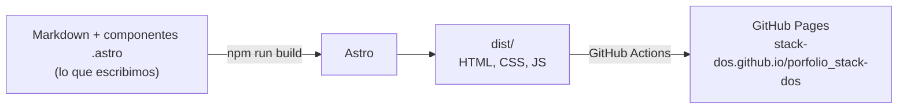

# Guía 01 — Scaffold de Astro + Starlight

Guía para quien nunca usó Node, npm, Astro ni Starlight. Al terminarla vas a entender cada archivo y cada comando de la **US-201** y por qué está ahí.

---

## 1. El panorama: qué estamos construyendo

Queremos un **sitio estático**: un conjunto de archivos HTML, CSS, JS e imágenes que cualquier servidor puede entregar tal cual. No hay base de datos ni backend: cada página ya existe como archivo `.html` cuando alguien la visita.

Escribir todo ese HTML a mano sería inmanejable, así que usamos un **generador de sitios estáticos** (Astro). Nosotros escribimos componentes y Markdown, Astro los convierte en HTML y GitHub Pages los publica.



Las piezas y qué rol cumple cada una:

| Pieza      | Qué es                                              | Para qué la usamos                                   |
| ---------- | --------------------------------------------------- | ---------------------------------------------------- |
| Node.js    | Programa que ejecuta JavaScript fuera del navegador | Correr Astro y todas las herramientas                |
| nvm        | Administrador de versiones de Node                  | Que todos usemos la misma versión                    |
| npm        | Gestor de paquetes de Node                          | Instalar Astro, Starlight y Prettier, correr scripts |
| Astro      | Generador de sitios (framework web)                 | Portfolio: landing, CVs, proyectos                   |
| Starlight  | Tema de documentación construido sobre Astro        | La wiki de las apps                                  |
| TypeScript | JavaScript con tipos                                | Validar configuración y contenido                    |
| Zod        | Librería de validación (viene con Astro)            | Definir qué campos lleva cada proyecto e integrante  |
| Prettier   | Formateador de código                               | Que todo el código tenga el mismo estilo             |

---

## 2. Node.js

JavaScript nació para correr **dentro del navegador**. **Node.js** es un programa que permite ejecutar JavaScript **en tu computadora**, como si fuera Python o Java. Gracias a eso existen herramientas escritas en JavaScript que corren en la terminal: Astro es una de ellas.

Nosotros **no** escribimos un servidor en Node. Solo lo usamos como "motor" para que Astro funcione mientras desarrollamos y cuando generamos el sitio. El sitio final publicado no necesita Node.

Comprobar si lo tenés instalado:

```bash
node --version   # ej: v22.11.0
```

**Versiones LTS:** Node publica versiones pares de soporte largo (_Long Term Support_: 20, 22, 24...). Son las recomendadas para proyectos. Las impares son experimentales.

---

## 3. nvm y `.nvmrc`

### El problema

Si Nico tiene Node 18 y Marcos Node 22, el mismo proyecto puede funcionar en una máquina y fallar en la otra. Astro además exige una versión mínima de Node.

### nvm

**nvm** (_Node Version Manager_) permite tener varias versiones de Node instaladas y cambiar entre ellas.

- En Windows se usa **nvm-windows** (<https://github.com/coreybutler/nvm-windows>), un programa distinto con comandos parecidos.
- En macOS/Linux, **nvm** (<https://github.com/nvm-sh/nvm>).

```bash
nvm install 22   # instala Node 22
nvm use 22       # pasa a usar Node 22
nvm list         # muestra las versiones instaladas
```

### `.nvmrc`

Es un archivo de texto en la raíz del repo que contiene **solo el número de versión**:

```text
22
```

Sirve como acuerdo del equipo: "este proyecto usa Node 22". En macOS/Linux, `nvm use` sin argumentos lo lee solo. En nvm-windows hay que escribir la versión a mano (`nvm use 22`), pero el archivo igual documenta cuál es. GitHub Actions también puede leerlo (`node-version-file: .nvmrc`) para que el CI use la misma versión que nosotros.

---

## 4. npm y `package.json`

### Qué es npm

**npm** (_Node Package Manager_) viene incluido con Node. Hace dos cosas:

1. **Descarga paquetes** (librerías de código de otros) desde el registro público <https://www.npmjs.com>. Astro, Starlight y Prettier son paquetes.
2. **Ejecuta scripts** definidos en el proyecto (`npm run dev`, `npm run build`).

### `package.json`

Es la "ficha" del proyecto. Ejemplo de cómo va a quedar:

```json
{
  "name": "porfolio-stack-dos",
  "type": "module",
  "version": "0.0.1",
  "scripts": {
    "dev": "astro dev",
    "build": "astro build",
    "preview": "astro preview",
    "astro": "astro"
  },
  "dependencies": {
    "@astrojs/starlight": "^0.36.0",
    "astro": "^5.15.0",
    "sharp": "^0.34.0"
  },
  "devDependencies": {
    "prettier": "^3.6.0",
    "prettier-plugin-astro": "^0.14.0"
  }
}
```

(Los números de versión son ilustrativos; los reales los pone el instalador.)

| Campo             | Qué significa                                                                          |
| ----------------- | -------------------------------------------------------------------------------------- |
| `name`, `version` | Identificación del proyecto. Como no lo publicamos en npm, casi no importan.           |
| `type: "module"`  | Los archivos `.js`/`.mjs` usan la sintaxis moderna `import`/`export`.                  |
| `scripts`         | Atajos de comandos. `npm run dev` ejecuta `astro dev`.                                 |
| `dependencies`    | Paquetes necesarios para construir el sitio.                                           |
| `devDependencies` | Paquetes que solo ayudan a desarrollar (Prettier). El sitio se genera igual sin ellos. |

**Versiones con `^`:** `^5.15.0` significa "cualquier 5.x.x igual o mayor a 5.15.0". Acepta mejoras y arreglos, pero no saltos a la 6 (que pueden romper cosas). Este esquema se llama **versionado semántico** (MAJOR.MINOR.PATCH).

### `package-lock.json`

Lo genera npm automáticamente. Anota la **versión exacta** de cada paquete instalado (y de los paquetes que esos paquetes usan). Gracias a él, `npm install` en otra máquina instala exactamente lo mismo. **Se commitea** y no se edita a mano.

### `node_modules/`

Carpeta donde npm guarda los paquetes descargados. Pesa cientos de MB y se puede regenerar con `npm install`, así que **no se commitea** (va en `.gitignore`).

### Comandos que vamos a usar

| Comando                    | Qué hace                                                                                                                              |
| -------------------------- | ------------------------------------------------------------------------------------------------------------------------------------- |
| `npm install`              | Lee `package.json` + `package-lock.json` y llena `node_modules/`. Se corre al clonar el repo o cuando alguien agrega una dependencia. |
| `npm install <paquete>`    | Agrega un paquete a `dependencies`.                                                                                                   |
| `npm install -D <paquete>` | Lo agrega a `devDependencies`.                                                                                                        |
| `npm run <script>`         | Ejecuta un script de `package.json`.                                                                                                  |
| `npm ci`                   | Como `install`, pero estricto: usa solo el lock. Lo usa el CI.                                                                        |
| `npm create <algo>`        | Corre un "creador" de proyectos (ver abajo).                                                                                          |
| `npx <herramienta>`        | Ejecuta una herramienta instalada en el proyecto (o la baja temporalmente). Ej: `npx prettier --write .`                              |

### `npm create astro@latest -- --template starlight`

Desarmado parte por parte:

- `npm create astro` → descarga y ejecuta el paquete `create-astro`, un asistente que arma un proyecto nuevo.
- `@latest` → la versión más reciente del asistente.
- `--` → "lo que sigue no es para npm, pasáselo al asistente".
- `--template starlight` → en vez de un proyecto vacío, usar la plantilla oficial de Starlight.

El asistente hace preguntas (carpeta, instalar dependencias, iniciar git). Como el repo ya existe, se elige la carpeta actual (`.`) y **no** inicializar git.

---

## 5. Astro

### Qué es

**Astro** (<https://astro.build>) es un framework para sitios centrados en contenido: portfolios, blogs, documentación. Su idea central: **generar HTML en el momento del build y mandar al navegador la menor cantidad de JavaScript posible** (por defecto, cero). Eso lo hace muy rápido y lo vuelve ideal para GitHub Pages, que solo sirve archivos estáticos.

### Dos momentos: desarrollo y build

| Comando           | Qué pasa                                                                                                                                       |
| ----------------- | ---------------------------------------------------------------------------------------------------------------------------------------------- |
| `npm run dev`     | Levanta un servidor local (`http://localhost:4321/porfolio_stack-dos/`). Al guardar un archivo, el navegador se actualiza solo (_hot reload_). |
| `npm run build`   | Genera el sitio final en `dist/`. Es lo que se publica. Si hay un error (contenido inválido, link roto de import), falla acá.                  |
| `npm run preview` | Sirve `dist/` localmente para ver el resultado exacto del build antes de publicar.                                                             |
| `npx astro check` | Revisa errores de tipos en archivos `.astro` y `.ts`. Lo exige la DoD en CI.                                                                   |

`dist/` se regenera en cada build, así que **no se commitea**.

### Archivos `.astro`

Un componente Astro tiene dos partes separadas por `---`:

```astro
---
// 1) "Frontmatter" de código: JavaScript/TypeScript que corre en el BUILD,
//    nunca en el navegador del visitante.
const nombre = 'Stack-dos';
const integrantes = ['Nico', 'Marcos'];
---

<!-- 2) Plantilla: HTML con expresiones entre llaves -->
<h1>Hola, somos {nombre}</h1>
<ul>
  {integrantes.map((i) => <li>{i}</li>)}
</ul>

<style>
  /* Este CSS solo afecta a este componente (scoped) */
  h1 { color: rebeccapurple; }
</style>
```

Al hacer el build, Astro ejecuta el bloque de código, rellena la plantilla y escribe HTML puro. El visitante recibe `<h1>Hola, somos Stack-dos</h1>` y nada de JavaScript.

### Rutas basadas en archivos

Cada archivo dentro de `src/pages/` se convierte en una página. La ruta del archivo es la URL:

| Archivo                         | URL                                                         |
| ------------------------------- | ----------------------------------------------------------- |
| `src/pages/index.astro`         | `/`                                                         |
| `src/pages/proyectos.astro`     | `/proyectos/`                                               |
| `src/pages/equipo/[slug].astro` | `/equipo/nicolas-pinera/`, `/equipo/marcos-battigane/`, ... |

Los corchetes `[slug]` indican una **ruta dinámica**: un solo archivo genera una página por cada integrante (lo vamos a usar en la US-402). Todas las URLs quedan precedidas por el `base` (ver sección 7).

### Componentes y layouts

Un componente puede usar a otro importándolo:

```astro
---
import Header from '../components/Header.astro';
---
<Header />
<main>...</main>
```

Un **layout** es un componente que envuelve páginas enteras (header, footer, `<head>`) para no repetir esa estructura en cada una.

### `public/` vs `src/`

- `src/` → código que Astro procesa (componentes, páginas, contenido, CSS).
- `public/` → archivos que se copian tal cual a `dist/` (favicon, `robots.txt`, imágenes que no necesitan optimizarse).

### Integraciones

Astro se extiende con **integraciones**: paquetes que agregan funcionalidades. Starlight es una integración. Se registran en `astro.config.mjs`.

---

## 6. Starlight

### Qué es

**Starlight** (<https://starlight.astro.build>) es la integración oficial de Astro para sitios de documentación. Ya trae resuelto lo que necesita una wiki:

- **Sidebar** de navegación generado desde las carpetas.
- **Buscador** (Pagefind, ver abajo) sin servicios externos.
- **Tema claro/oscuro** con selector.
- Tabla de contenidos por página, botones "anterior/siguiente".
- Fecha de última actualización (`lastUpdated`).
- Diseño adaptado a mobile, accesibilidad e internacionalización.

### Cómo se escribe una página

Cada página de la wiki es un archivo `.md` o `.mdx` dentro de `src/content/docs/`. La ruta del archivo es la URL:

| Archivo                                   | URL                   |
| ----------------------------------------- | --------------------- |
| `src/content/docs/index.mdx`              | `/`                   |
| `src/content/docs/apps/stat-pro/index.md` | `/apps/stat-pro/`     |
| `src/content/docs/apps/stat-pro/uso.md`   | `/apps/stat-pro/uso/` |

Ejemplo de página:

```markdown
---
title: Arquitectura
description: Cómo está armada Stat Pro por dentro.
---

## Capas

Stat Pro se divide en...
```

`title` es obligatorio: Starlight lo usa como `<h1>` y en el sidebar.

### Pagefind

Es el buscador que trae Starlight. Al hacer `npm run build`, **indexa todas las páginas** y genera archivos de índice dentro de `dist/`. El buscador funciona 100% en el navegador, sin servidor. Por eso **el buscador no funciona en `npm run dev`**: hay que hacer build y `npm run preview` para probarlo.

### Starlight + portfolio en el mismo proyecto

Starlight maneja las rutas de `src/content/docs/` (la wiki). Las páginas del portfolio (landing, equipo, proyectos) van como páginas Astro normales en `src/pages/`. Las dos conviven en el mismo sitio; la US-203 se encarga de que se vean iguales.

> Ojo: si existen a la vez `src/pages/index.astro` y `src/content/docs/index.mdx`, ambas pelean por `/`. La plantilla de Starlight trae el `index.mdx`; cuando hagamos la landing propia hay que decidir cuál queda.

---

## 7. `astro.config.mjs`

Es **el archivo de configuración del sitio**. La extensión `.mjs` significa "módulo JavaScript": usa `import`/`export`. Astro lo lee al arrancar `dev` y `build`.

Así queda según la US-201:

```js
// @ts-check
import { defineConfig } from "astro/config";
import starlight from "@astrojs/starlight";

export default defineConfig({
  site: "https://stack-dos.github.io",
  base: "/porfolio_stack-dos",
  integrations: [
    starlight({
      title: "Stack-dos",
      defaultLocale: "root",
      locales: {
        root: { label: "Español", lang: "es" },
      },
      social: [
        {
          icon: "github",
          label: "GitHub",
          href: "https://github.com/stack-dos",
        },
      ],
      lastUpdated: true,
    }),
  ],
});
```

Línea por línea:

| Línea                       | Qué hace                                                                                                                                                                                                  |
| --------------------------- | --------------------------------------------------------------------------------------------------------------------------------------------------------------------------------------------------------- |
| `// @ts-check`              | Le pide al editor que revise tipos aunque sea JavaScript: si escribís mal una opción, VS Code lo subraya.                                                                                                 |
| `import { defineConfig }`   | Función de Astro que envuelve la configuración. No cambia nada en ejecución; da autocompletado.                                                                                                           |
| `import starlight`          | Trae la integración de Starlight.                                                                                                                                                                         |
| `site`                      | Dominio donde se publica. Astro lo usa para generar URLs absolutas (sitemap, links canónicos, metadatos para compartir).                                                                                  |
| `base`                      | Subcarpeta dentro del dominio (ver abajo).                                                                                                                                                                |
| `integrations: [...]`       | Lista de integraciones activas.                                                                                                                                                                           |
| `title`                     | Nombre que aparece en el header y en la pestaña del navegador.                                                                                                                                            |
| `defaultLocale` + `locales` | Idioma del sitio. `root` significa "sin prefijo en la URL" (`/apps/...` en vez de `/es/apps/...`). `lang: 'es'` pone los textos de la interfaz (buscar, siguiente, etc.) en español y `<html lang="es">`. |
| `social`                    | Íconos de redes en el header; acá solo el GitHub de la organización.                                                                                                                                      |
| `lastUpdated: true`         | Cada página muestra "Última actualización: fecha", tomada del **último commit de git** que tocó ese archivo (ADR-005).                                                                                    |

### Por qué hace falta `base`

GitHub Pages publica los repos de una organización como `https://<org>.github.io/<repo>/`. Nuestro sitio no vive en la raíz del dominio sino en `/porfolio_stack-dos/`.

Sin `base`, Astro generaría links como `/proyectos/`, que apuntan a `https://stack-dos.github.io/proyectos/` → **404**. Con `base`, genera `/porfolio_stack-dos/proyectos/`.

Consecuencia práctica: en componentes propios, los links internos se arman con el base:

```astro
<a href={`${import.meta.env.BASE_URL}/proyectos/`}>Proyectos</a>
```

(Starlight y los links de Markdown dentro de la wiki ya lo resuelven solos para su sidebar; los links escritos a mano en Markdown deben incluir el base.)

### `lastUpdated` y git

Como la fecha sale del historial de git, en el CI hay que clonar el repo **completo** (`fetch-depth: 0` en GitHub Actions). Si no, todas las páginas mostrarían la fecha del último commit. Lo vemos en la US-301.

---

## 8. Markdown y frontmatter

### Markdown

Formato de texto con marcas simples que se convierten en HTML:

```markdown
## Título de sección

Texto con **negrita**, _cursiva_ y `código`.

- Item de lista
- [Un link](https://astro.build)
```

**MDX** (`.mdx`) es Markdown que además permite usar componentes dentro del texto (por ejemplo, los componentes de Starlight como `<Card>` o `<Tabs>`). Si una página no los necesita, usá `.md`.

### Frontmatter (YAML)

El bloque entre `---` al principio de un `.md` son **metadatos** escritos en **YAML**, un formato de datos `clave: valor`:

```yaml
---
nombre: Stat Pro
estado: en-desarrollo
stack: [Python, FastAPI, React] # lista
repo: https://github.com/Stack-dos/app_estadisticas
wiki: /apps/stat-pro/ # opcional
---
```

Reglas de YAML que suelen romper cosas:

- La indentación es con **espacios**, nunca tabs.
- Después de `:` va un espacio.
- Si un texto contiene `:` o empieza con caracteres especiales, va entre comillas: `titulo: "Stat Pro: estadísticas"`.

> No confundir: el `---` de un `.md` encierra YAML (datos). El `---` de un `.astro` encierra código JavaScript. Mismo símbolo, cosas distintas.

---

## 9. Content collections y `src/content.config.ts`

### Qué son

Una **content collection** es una carpeta de archivos Markdown del mismo tipo (todos proyectos, todos integrantes) con un **esquema**: la lista de campos que debe tener su frontmatter y de qué tipo es cada uno.

Ventajas:

- Si alguien olvida un campo obligatorio o escribe `estado: publicad`, **el build falla** con un mensaje claro, en vez de publicar una página rota.
- Desde código se consultan con `getCollection('proyectos')` y vienen tipados (autocompletado en el editor).

### El archivo

Se definen en `src/content.config.ts`. Starlight ya necesita la colección `docs`; la US-202 agrega `proyectos` e `integrantes`. Esquema base:

```ts
import { defineCollection, z } from "astro:content";
import { glob } from "astro/loaders";
import { docsLoader } from "@astrojs/starlight/loaders";
import { docsSchema } from "@astrojs/starlight/schema";

export const collections = {
  // Colección que usa Starlight para la wiki
  docs: defineCollection({ loader: docsLoader(), schema: docsSchema() }),

  // Ejemplo de colección propia (se completa en la US-202)
  proyectos: defineCollection({
    loader: glob({ pattern: "**/*.md", base: "./src/content/proyectos" }),
    schema: z.object({
      nombre: z.string(),
      estado: z.enum([
        "planificado",
        "en-desarrollo",
        "publicado",
        "archivado",
      ]),
      repo: z.string().url(),
      wiki: z.string().optional(),
    }),
  }),
};
```

| Pieza              | Qué hace                                                                                                                                                                      |
| ------------------ | ----------------------------------------------------------------------------------------------------------------------------------------------------------------------------- |
| `defineCollection` | Declara una colección.                                                                                                                                                        |
| `loader`           | De dónde salen los archivos. `glob` = "todos los `.md` de esta carpeta".                                                                                                      |
| `schema`           | Qué forma debe tener el frontmatter.                                                                                                                                          |
| `z`                | **Zod**, librería de validación incluida en Astro. `z.string()` = texto, `z.enum([...])` = uno de esos valores, `.url()` = debe ser URL válida, `.optional()` = puede faltar. |

---

## 10. TypeScript y `tsconfig.json`

**TypeScript** es JavaScript con tipos: indicás que algo es un texto, un número o una lista, y el editor/compilador avisa si lo usás mal **antes** de ejecutar. Astro lo soporta sin configuración extra; no hace falta saber TypeScript avanzado para este proyecto, alcanza con leer los esquemas de la sección anterior.

`tsconfig.json` configura TypeScript. La plantilla trae:

```json
{
  "extends": "astro/tsconfigs/strict",
  "include": [".astro/types.d.ts", "**/*"],
  "exclude": ["dist"]
}
```

- `extends` → hereda la configuración recomendada por Astro en modo estricto (más chequeos).
- `include`/`exclude` → qué archivos revisar. `.astro/types.d.ts` lo genera Astro con los tipos de las colecciones.

La carpeta `.astro/` es generada automáticamente: **no se commitea**.

---

## 11. Prettier y `.prettierrc`

### Qué es

**Prettier** es un **formateador**: reescribe el código para que siga siempre el mismo estilo (comillas, sangría, largo de línea, comas). No cambia lo que hace el código, solo cómo se ve. Así los PRs muestran cambios reales y no discusiones de espacios vs tabs.

### Instalación

```bash
npm install -D prettier prettier-plugin-astro
```

`prettier-plugin-astro` le enseña a Prettier a formatear archivos `.astro`, que no conoce de fábrica.

### `.prettierrc`

Archivo de configuración (JSON) en la raíz:

```json
{
  "singleQuote": true,
  "printWidth": 100,
  "plugins": ["prettier-plugin-astro"],
  "overrides": [{ "files": "*.astro", "options": { "parser": "astro" } }]
}
```

| Opción        | Qué hace                                                              |
| ------------- | --------------------------------------------------------------------- |
| `singleQuote` | Usa `'comillas simples'` en JS/TS.                                    |
| `printWidth`  | Largo máximo de línea antes de cortarla.                              |
| `plugins`     | Activa el soporte para `.astro`.                                      |
| `overrides`   | Reglas para ciertos archivos: los `.astro` usan el parser del plugin. |

Opcional: un `.prettierignore` (misma sintaxis que `.gitignore`) para excluir carpetas como `dist/`. Prettier ya ignora `node_modules/` por defecto.

### Uso

```bash
npx prettier --write .   # formatea todo el proyecto
npx prettier --check .   # solo verifica, no modifica (útil en CI)
```

En VS Code: instalar la extensión **Prettier – Code formatter** y activar _Format On Save_.

---

## 12. Estructura final del proyecto

Después de la US-201 el repo queda así:

```text
porfolio_stack-dos/
├── .github/
│   └── pull_request_template.md
├── docs/                    ← documentación del proyecto (PRD, ADRs, guías). NO se publica.
├── public/                  ← se copia tal cual a dist/ (favicon, etc.)
├── src/
│   ├── assets/              ← imágenes que Astro optimiza
│   ├── content/
│   │   └── docs/            ← páginas de la wiki (Starlight)
│   └── content.config.ts    ← colecciones y sus esquemas
├── .gitignore
├── .nvmrc                   ← versión de Node
├── .prettierrc              ← estilo de código
├── astro.config.mjs         ← configuración del sitio
├── package.json             ← dependencias y scripts
├── package-lock.json        ← versiones exactas
├── tsconfig.json            ← configuración de TypeScript
└── README.md
```

Generados y fuera de git: `node_modules/`, `dist/`, `.astro/`.

> Ojo con los nombres: `docs/` (raíz) es nuestra documentación interna; `src/content/docs/` es el contenido de la wiki publicada. Son cosas distintas.

---

## 13. Paso a paso de la US-201

1. Instalar Node LTS con nvm y verificar: `node --version`, `npm --version`.
2. Crear una rama desde `develop`: `git checkout -b feature/us-201-scaffold`.
3. En la raíz del repo: `npm create astro@latest -- --template starlight`. Elegir la carpeta actual, instalar dependencias: sí, git: no.
4. Editar `astro.config.mjs` como en la sección 7.
5. Crear `.nvmrc` con la versión mayor de Node (ej. `22`).
6. Instalar Prettier y crear `.prettierrc` (sección 11). Correr `npx prettier --write .`.
7. Verificar que `.gitignore` incluye `node_modules/`, `dist/` y `.astro/` (la plantilla ya los trae).
8. Probar: `npm run dev` (abrir `http://localhost:4321/porfolio_stack-dos/`) y `npm run build` sin errores.
9. Commit y PR a `develop` con la plantilla de PR.

---

## 14. Problemas comunes

| Síntoma                                                 | Causa probable / solución                                                                      |
| ------------------------------------------------------- | ---------------------------------------------------------------------------------------------- |
| `'npm' no se reconoce como comando`                     | Node no está instalado o la terminal se abrió antes de instalarlo. Cerrar y abrir la terminal. |
| Astro dice que la versión de Node no es compatible      | `nvm use` con la versión de `.nvmrc`.                                                          |
| `Cannot find module 'astro'`                            | Falta `npm install`.                                                                           |
| El sitio local muestra 404 en `localhost:4321/`         | Es por el `base`: la URL correcta es `localhost:4321/porfolio_stack-dos/`.                     |
| Publicado, los links o CSS dan 404                      | Links escritos a mano sin el `base`.                                                           |
| El buscador no aparece o no encuentra nada en `dev`     | Normal: Pagefind solo funciona tras `npm run build` + `npm run preview`.                       |
| El build falla con un error de un campo del frontmatter | El contenido no cumple el esquema de `content.config.ts`. El mensaje indica archivo y campo.   |
| Error de YAML (`bad indentation`, `unexpected`)         | Tabs en vez de espacios, o un `:` sin comillas en un valor.                                    |
| Conflicto en `package-lock.json` al mergear             | Aceptar una versión y correr `npm install` para que npm lo regenere.                           |

---

## 15. Glosario

| Término               | Significado                                                                      |
| --------------------- | -------------------------------------------------------------------------------- |
| Build                 | Proceso que convierte el código fuente en el sitio final (`dist/`).              |
| Sitio estático        | Sitio compuesto solo de archivos ya generados; no ejecuta código en el servidor. |
| Framework             | Conjunto de herramientas y convenciones para construir algo sin empezar de cero. |
| Paquete / dependencia | Librería de código de terceros que el proyecto usa.                              |
| Integración           | Paquete que extiende Astro (Starlight es una).                                   |
| Componente            | Pieza reutilizable de interfaz (un `.astro`).                                    |
| Layout                | Componente que envuelve páginas enteras.                                         |
| Frontmatter           | Bloque entre `---` al inicio de un archivo (YAML en `.md`, código en `.astro`).  |
| Slug                  | Nombre corto en minúsculas y con guiones usado en URLs: `nicolas-pinera`.        |
| Esquema               | Definición de qué campos y tipos debe tener un dato.                             |
| Hot reload            | Recarga automática del navegador al guardar un archivo en `dev`.                 |
| Base path             | Subcarpeta del dominio donde vive el sitio (`/porfolio_stack-dos`).              |
| LTS                   | _Long Term Support_: versión con soporte extendido.                              |
| CI                    | Integración continua: GitHub Actions corre build y chequeos en cada PR.          |

## Para seguir leyendo

- Tutorial oficial de Astro (en español): <https://docs.astro.build/es/tutorial/0-introduction/>
- Documentación de Starlight: <https://starlight.astro.build/es/>
- Configuración de Starlight: <https://starlight.astro.build/es/reference/configuration/>
- Content collections: <https://docs.astro.build/es/guides/content-collections/>
- Prettier: <https://prettier.io/docs/>
