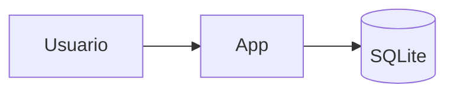

# Guía 04 — Plugins de la wiki y Open Graph

Qué agrega cada plugin instalado en la US-204, cómo se usa al escribir contenido y cómo verificar que funciona.

## 1. Integraciones vs plugins

- **Integración de Astro**: extiende Astro entero. Se registra en `integrations: [...]`. Ejemplos: Starlight y `astro-mermaid`.
- **Plugin de Starlight**: extiende solo Starlight. Se registra en `starlight({ plugins: [...] })`. Ejemplos: el validador de links y el zoom de imágenes.

Antes de instalar cualquiera de los dos, se revisa que soporte nuestras versiones de Astro y Starlight:

```bash
npm view starlight-image-zoom peerDependencies
# { astro: '>=7.2.10', '@astrojs/starlight': '>=0.42.0' }
npm ls astro @astrojs/starlight   # versiones instaladas
```

Si nuestras versiones no entran en el rango, el plugin todavía no las soporta: no se instala.

## 2. Mermaid: diagramas escritos como texto

Paquetes: `astro-mermaid` + `mermaid`.

En cualquier `.md` de la wiki:

````md

````

Se dibuja como diagrama en el navegador y cambia de colores con el modo claro/oscuro (`autoTheme: true`). Tipos útiles: `flowchart` (flujos), `sequenceDiagram` (interacciones), `erDiagram` (modelo de datos), `classDiagram`. Para probar un diagrama antes de pegarlo: <https://mermaid.live>.

La integración va **antes** que `starlight()` en el array `integrations`, para que transforme los bloques `mermaid` antes de que Starlight los trate como código común.

## 3. Validador de links: los links rotos no llegan a producción

Paquete: `starlight-links-validator`.

Al final de `npm run build`, revisa cada link interno del contenido de la wiki. Si alguno apunta a una página que no existe, **el build falla** y muestra el archivo y el link:

```txt
   ╭─ index.mdx
11 | /guides/example/
   ·               ╰── invalid link
```

Errores típicos:

| Error                         | Causa                                       | Solución                                 |
| ----------------------------- | ------------------------------------------- | ---------------------------------------- |
| `invalid link`                | Falta la base o la página no existe         | Escribir `/porfolio_stack-dos/...`       |
| `invalid link to custom page` | El link apunta a una página de `src/pages/` | Agregar la ruta a `exclude` en la config |
| `invalid hash`                | El `#ancla` no coincide con ningún título   | Revisar el título (minúsculas, guiones)  |

`exclude` existe porque el plugin solo conoce las páginas de la wiki, no las del portfolio. Ahí ya están listadas `/`, `/proyectos/` y `/equipo/**`. Si creás una página nueva en `src/pages/` y la linkeás desde la wiki, agregala a esa lista.

El validador solo revisa links internos. Los externos (GitHub, LinkedIn) no se validan.

## 4. Zoom de imágenes

Paquete: `starlight-image-zoom`. No requiere nada al escribir: toda imagen de la wiki se amplía al hacer clic. Ideal para capturas de pantalla:

```md

```

El texto entre `[ ]` es el texto alternativo, para lectores de pantalla. **Siempre** tiene que describir la imagen.

## 5. Open Graph: cómo se ve el link al compartirlo

Cuando pegás un link en WhatsApp, LinkedIn o Slack, esas apps leen unas etiquetas `<meta property="og:...">` del HTML para armar la "tarjeta" con título, descripción e imagen.

| Etiqueta         | De dónde sale                                                                          |
| ---------------- | -------------------------------------------------------------------------------------- |
| `og:title`       | `title` de la página (frontmatter del `.md` o de `StarlightPage`)                      |
| `og:description` | `description` de la página; si no tiene, la `description` global de `astro.config.mjs` |
| `og:url`         | Lo calcula Starlight a partir de `site` + `base`                                       |
| `og:image`       | La agregamos nosotros en `head`: `public/og.png` (1200×630)                            |

Starlight genera las tres primeras, tanto en la wiki como en las páginas con `StarlightPage`. Nosotros solo sumamos la imagen, para todo el sitio, en `astro.config.mjs`:

```js
head: [
  { tag: 'meta', attrs: { property: 'og:image', content: `${site}${base}/og.png` } },
  { tag: 'meta', attrs: { name: 'twitter:card', content: 'summary_large_image' } },
],
```

La URL de la imagen tiene que ser **absoluta** (con `https://`), porque la lee un servidor externo.

Buenas prácticas:

- Ponele `description` a cada página: es lo que se lee en la tarjeta.
- Para cambiar la imagen, reemplazá `public/og.png` por otra de **1200×630 px** con el mismo nombre.

Cómo verificarlo:

- **Local**: `npm run build` y buscar `og:` en `dist/<ruta>/index.html`.
- **Con el sitio publicado**: <https://www.opengraph.xyz> o el Post Inspector de LinkedIn (<https://www.linkedin.com/post-inspector/>). Ojo: WhatsApp y LinkedIn guardan la tarjeta en caché; el Post Inspector la refresca.

## 6. Resumen de la configuración

```js
integrations: [
  mermaid({ autoTheme: true }),                        // diagramas
  starlight({
    description: '...',                                // descripción por defecto (OG)
    head: [ /* og:image */ ],
    plugins: [
      starlightLinksValidator({ exclude: [/* páginas de src/pages */] }),
      starlightImageZoom(),
    ],
  }),
],
```
