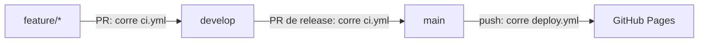

# Guía 05 — CI/CD con GitHub Actions y GitHub Pages

Cómo se valida cada PR (CI) y cómo se publica el sitio (CD), y qué hay que configurar en GitHub para que funcione (US-301 y US-302).

## 1. Conceptos

- **CI (integración continua)**: cada vez que alguien abre o actualiza un PR, un servidor de GitHub instala el proyecto desde cero y corre los chequeos. Si algo falla, el PR queda en rojo.
- **CD (despliegue continuo)**: cada vez que algo llega a `main`, el sitio se construye y se publica solo.
- **GitHub Actions**: el servicio de GitHub que ejecuta esas tareas. Se configura con archivos `.yml` en `.github/workflows/`.
- **GitHub Pages**: el hosting gratuito de GitHub para sitios estáticos. Sirve nuestro `dist/` en `https://stack-dos.github.io/porfolio_stack-dos/`.



## 2. Anatomía de un workflow (`.yml`)

YAML es un formato de configuración basado en la indentación: los espacios importan y **no se usan tabs**.

```yaml
name: CI # nombre que se ve en la pestaña Actions

on: # cuándo se ejecuta (el "trigger")
  pull_request:
    branches: [develop, main]

jobs: # trabajos; cada uno corre en una máquina nueva
  build: # id del job
    runs-on: ubuntu-latest # sistema operativo de la máquina
    steps: # pasos, en orden
      - uses: actions/checkout@v7 # "uses" = usar una action hecha por otros
      - run: npm ci # "run" = ejecutar un comando
```

- **Action**: un paso reutilizable publicado en GitHub (`dueño/repo@versión`). Ejemplos: `actions/checkout` descarga el código y `actions/setup-node` instala Node.
- **`@v7`**: la versión mayor de la action. Se actualiza a mano cuando sale una nueva.
- **`permissions`**: qué puede hacer el workflow con el repo. Se dan los mínimos necesarios.
- **`concurrency`**: qué pasa si el workflow se dispara dos veces seguidas: cancelar la corrida anterior (CI) o esperar a que termine (deploy).

## 3. `ci.yml`: el check de los PR

Archivo: [.github/workflows/ci.yml](../../.github/workflows/ci.yml). Se ejecuta en cada PR hacia `develop` o `main`, y repite lo mismo que harías en local:

| Paso              | Qué detecta                                                              |
| ----------------- | ------------------------------------------------------------------------ |
| `npm ci`          | `package-lock.json` desactualizado respecto de `package.json`            |
| `npx astro check` | Errores de TypeScript y de los `.astro`                                  |
| `npm run build`   | Frontmatter inválido (Zod), links internos rotos, errores de compilación |

Para correr lo mismo en tu máquina antes de abrir el PR: `make ci`.

Si el check falla en un PR:

1. Entrá a la pestaña **Checks** del PR, o hacé clic en el ✗ rojo → **Details**.
2. Abrí el paso en rojo y leé el error. Los más comunes están en la sección 9 dla guía [CONTRIBUIR](../CONTRIBUIR.md).
3. Arreglalo y pusheá a la misma rama. El check vuelve a correr solo.

## 4. `deploy.yml`: la publicación

Archivo: [.github/workflows/deploy.yml](../../.github/workflows/deploy.yml). Se ejecuta en cada push a `main` (es decir, al mergear el PR de release) o a mano.

Tiene dos jobs:

1. **`build`**: `withastro/action` instala Node 22, corre `npm ci` y `astro build`, y sube `dist/` como _artifact_ de Pages (un paquete con el sitio listo).
2. **`deploy`**: `actions/deploy-pages` toma ese artifact y lo publica. Necesita los permisos `pages: write` e `id-token: write`.

Para relanzarlo a mano: pestaña **Actions** → **Deploy** → **Run workflow** → rama `main`.

## 5. Configuración en GitHub (una sola vez)

Hacela un admin de la organización o del repo.

### 5.1 Activar GitHub Pages

1. Repo → **Settings** → **Pages** (menú izquierdo, sección _Code and automation_).
2. En **Build and deployment** → **Source**, elegí **GitHub Actions**. No elijas "Deploy from a branch": esa opción es para sitios sin build.
3. No hace falta tocar nada más: ni rama, ni carpeta, ni dominio propio.

### 5.2 Visibilidad del repo

En el plan gratuito de GitHub, Pages solo funciona con **repos públicos**. Si el repo es privado, hay que hacerlo público (Settings → General → Danger Zone → Change visibility) o tener un plan pago en la organización.

### 5.3 Entorno `github-pages`

Al activar Pages, GitHub crea solo el entorno `github-pages` (Settings → **Environments**). Por defecto solo permite deploys desde la **rama por defecto** del repo.

- Si la rama por defecto es `main`, no hay que hacer nada.
- Si la rama por defecto es `develop`, entrá a Environments → `github-pages` → **Deployment branches and tags** → agregá `main`. Si no, el deploy falla con _"Branch main is not allowed to deploy to github-pages"_.

### 5.4 Proteger `develop` y `main` (branch protection)

Settings → **Branches** → **Add branch ruleset**, o "Add classic branch protection rule". Repetilo para `develop` y para `main`:

| Opción                                  | Valor                                                       |
| --------------------------------------- | ----------------------------------------------------------- |
| Branch name pattern / target            | `develop` (y otra regla igual para `main`)                  |
| Require a pull request before merging   | ✓, con **1** aprobación requerida                           |
| Require status checks to pass           | ✓ → buscar y agregar el check **`build`** (del workflow CI) |
| Require branches to be up to date       | ✓ (recomendado)                                             |
| Block force pushes / Restrict deletions | ✓                                                           |

El check `build` solo aparece en el buscador **después de que corrió al menos una vez**. Por eso, primero abrí un PR cualquiera para que se ejecute, y después configurá la regla.

## 6. Primer deploy: checklist

1. Settings → Pages → Source: **GitHub Actions** (5.1).
2. Mergear a `develop` el PR con los workflows. El CI tiene que dar verde.
3. Abrir el PR de release `develop` → `main` y mergearlo.
4. En **Actions** → **Deploy**, esperar a que los dos jobs terminen en verde. El job `deploy` muestra el link.
5. Abrir <https://stack-dos.github.io/porfolio_stack-dos/> y revisar que:
   - carguen los estilos y las imágenes (si no cargan, el problema suele ser la `base`);
   - funcionen los links del header y el buscador;
   - aparezca la página `/porfolio_stack-dos/apps/stat-pro/`.
6. Crear el tag y el release (`v0.x` o `v1.0.0`, según el roadmap del PRD).

## 7. Problemas frecuentes

| Síntoma                                                 | Causa / solución                                                                     |
| ------------------------------------------------------- | ------------------------------------------------------------------------------------ |
| Deploy: `Get Pages site failed` / `Not Found`           | Pages no está activado o Source no es "GitHub Actions" (5.1)                         |
| Deploy: `Branch "main" is not allowed to deploy`        | Regla del entorno `github-pages` (5.3)                                               |
| Sitio sin estilos, links a 404                          | Algún link sin la base; revisar `base` en `astro.config.mjs`                         |
| CI: `npm ci` falla con _lock file out of sync_          | Correr `npm install` en local y commitear `package-lock.json`                        |
| El check `build` no aparece al configurar la protección | Todavía no corrió nunca: abrir un PR primero                                         |
| Cambié algo y el sitio no se actualiza                  | ¿Se mergeó a `main`? Los PR a `develop` no publican. Si sí, forzar recarga (Ctrl+F5) |
