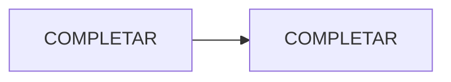

import { Tabs, TabItem, Steps } from '@astrojs/starlight/components';

<Tabs>
<TabItem label="Inicio" icon="information">

{/* Si la app no está publicada todavía, dejá este aviso con la versión/hito actual. Si ya está estable, borralo. */}

:::caution[En desarrollo — COMPLETAR versión]
COMPLETAR: qué funciona hoy y en qué se está trabajando. Esta wiki se actualiza al cerrar cada versión.
:::

## Qué es

COMPLETAR: para quién es y qué problema resuelve, en 2 o 3 oraciones.

## El problema

{/* Opcional: una tabla de los problemas concretos que motivaron la app. */}

| Problema  | Impacto   |
| --------- | --------- |
| COMPLETAR | COMPLETAR |

## Qué hace

- COMPLETAR: funcionalidad principal.
- COMPLETAR: ...

**Fuera de alcance:** COMPLETAR lo que deliberadamente no hace (evita expectativas falsas).

## Roadmap

| Versión | Contenido | Estado      |
| ------- | --------- | ----------- |
| v0.1    | COMPLETAR | 🚧 En curso |
| v1.0    | COMPLETAR | Planificado |

## Links

- Repositorio: COMPLETAR (solo si es público)
- Instalación, arquitectura y uso: en las pestañas de arriba.

</TabItem>
<TabItem label="Instalación" icon="laptop">

## Requisitos

- COMPLETAR: lenguaje/runtime y versión mínima.
- COMPLETAR: herramientas (Docker, gestor de dependencias, etc.).

## Pasos

{/* <Steps> numera los pasos. Adentro solo puede ir una lista numerada; el código va indentado 3 espacios. */}

<Steps>

1. Clonar el repositorio:

   ```bash
   git clone COMPLETAR
   cd COMPLETAR
   ```

2. COMPLETAR: instalar dependencias.

   ```bash
   # COMPLETAR
   ```

3. Verificar que quedó bien instalado:

   ```bash
   # COMPLETAR: ej. --help o un health check
   ```

</Steps>

Siguiente paso: la pestaña **Uso**.

</TabItem>
<TabItem label="Arquitectura" icon="setting">

## Stack

| Pieza     | Tecnología | Por qué   |
| --------- | ---------- | --------- |
| COMPLETAR | COMPLETAR  | COMPLETAR |

## Componentes

{/* Un diagrama vale más que un párrafo. Probalo antes en https://mermaid.live */}



COMPLETAR: qué hace cada capa/componente y cómo se comunican.

## Modelo de datos

{/* Opcional: un erDiagram con las entidades principales. */}

## Decisiones de arquitectura

| ADR | Decisión  |
| --- | --------- |
| 001 | COMPLETAR |

</TabItem>
<TabItem label="Uso" icon="seti:shell">

Para instalarla, ver la pestaña **Instalación**.

## Flujo típico

{/* Los pasos que sigue un usuario de punta a punta. */}

<Steps>

1. COMPLETAR: primer paso (con el comando, si aplica).
2. COMPLETAR: ...

</Steps>

## COMPLETAR (una sección por funcionalidad, comando o endpoint)

```bash
# COMPLETAR: ejemplo real, copiable
```

{/* Capturas: guardalas en ./capturas/ y usá . Se amplían con un clic. */}

</TabItem>
</Tabs>
