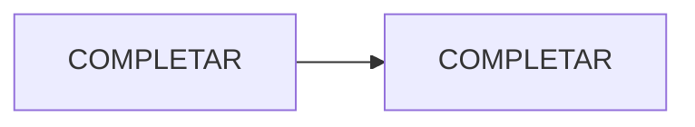

Para instalarla, ver [Instalación](/porfolio_stack-dos/apps/SLUG/instalacion/).

## Flujo típico

<!-- Los pasos que sigue un usuario de punta a punta. -->



## COMPLETAR (una sección por funcionalidad, comando o endpoint)

```bash
# COMPLETAR: ejemplo real, copiable
```

<!-- Capturas: guardalas en ./capturas/ y usá . Se amplían con un clic. -->
