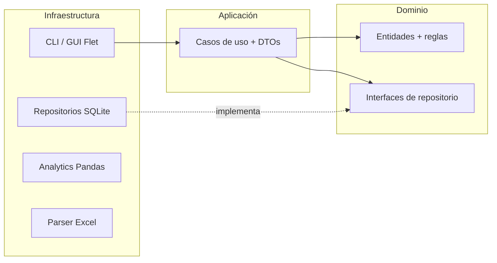
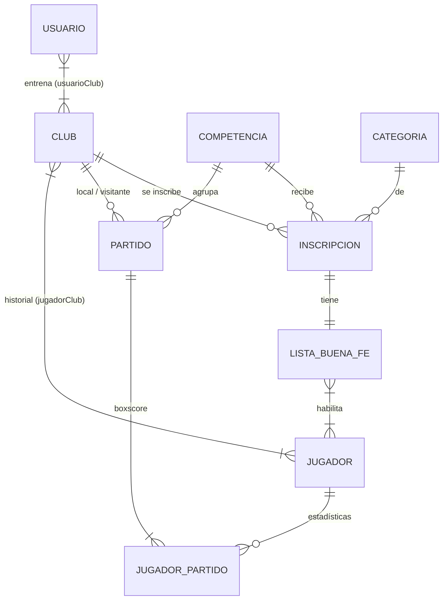

## Stack

| Pieza           | Tecnología                        | Por qué                                                            |
| --------------- | --------------------------------- | ------------------------------------------------------------------ |
| Persistencia    | SQLite (`sqlite3` de la stdlib)   | Local-first: sin servidor, funciona offline, transacciones ACID    |
| Análisis        | Pandas                            | Fórmulas vectorizadas sobre las vistas SQL                         |
| Interfaz (v0.1) | CLI con `argparse` + `tabulate`   | Validar el núcleo antes de invertir en la GUI                      |
| Interfaz (v1.0) | Flet                              | Python puro para desktop y Android, reusa los casos de uso         |
| Gráficos / PDF  | matplotlib / reportlab            | Sin dependencias de sistema, funcionan offline                     |
| Calidad         | pytest, ruff, mypy `--strict`, uv | Dependencias fijadas con `uv.lock`, mismas versiones en local y CI |

## Capas (Clean + Hexagonal)

- **Dominio** (`src/dominio/`): entidades puras (`@dataclass`) con sus validaciones, excepciones de negocio e **interfaces** de repositorio (`ABC`). No importa `sqlite3`, `pandas` ni ningún framework.
- **Aplicación** (`src/aplicacion/`): un caso de uso por acción del usuario (`RegistrarJugadorUseCase`, `InscribirClubEnCompetenciaUseCase`…), con un único método `ejecutar(dto)`. Recibe los repositorios por constructor (inyección de dependencias).
- **Infraestructura** (`src/infraestructura/`): implementaciones concretas — repositorios SQLite, CLI, motor Pandas, parser Excel, reportes y seguridad. Es la única capa que conoce las librerías externas.

**Regla de dependencias:** `dominio ← aplicación ← infraestructura`. El dominio no conoce a nadie; por eso los casos de uso se testean con repositorios falsos, sin base de datos.

### DTOs

Los casos de uso reciben y devuelven **DTOs** (dataclasses planas, sin lógica). La UI nunca toca entidades de dominio: si cambia una entidad, la CLI no se rompe, y viceversa.

### Composition root

`src/main.py` arma el parser de la CLI y despacha el comando. Cada comando construye las dependencias que necesita (`ejecutar(args, repo=None)`): en producción abre la base real; en los tests se le inyecta un repositorio falso. Los errores de negocio (`ErrorDeDominio`) se atrapan en un único lugar y se muestran como mensaje, sin traceback.

## Modelo de datos

- `jugadorPartido` es la **tabla de hechos** del motor estadístico: más de 20 métricas por jugador y partido (puntos, T1/T2/T3, rebotes, asistencias, recuperos, pérdidas, tapones, faltas, minutos).
- Cuatro **vistas SQL** son el contrato estable que consume Pandas: `v_partidos_resumen`, `v_boxscore_completo`, `v_jugador_totales_temporada` y `v_listas_detalle`. Todas protegen las divisiones por cero.

## Reglas de negocio destacadas

- Email de usuario único; la contraseña nunca se guarda en texto plano (PBKDF2 con _salt_ por usuario en v0.1).
- DNI de jugador único; un jugador no puede tener dos vínculos activos ni períodos superpuestos con clubes.
- Una inscripción es única por club + competencia + categoría, y tiene una única lista de buena fe.
- Solo jugadores habilitados en la lista pueden figurar en un partido oficial.
- Un partido no puede tener el mismo club como local y visitante, y su carga es **atómica**: partido y boxscore se guardan juntos o no se guarda nada.
- Estadísticas coherentes: convertidos ≤ lanzados, valores no negativos y `puntos = T1C + 2·T2C + 3·T3C`.

## Motor estadístico (v0.2)

Funciones puras sobre DataFrames, sin acceso a la base:

| Métrica    | Fórmula                                                      |
| ---------- | ------------------------------------------------------------ |
| eFG%       | `(T2C + 1.5 × T3C) / (T2L + T3L)`                            |
| EFF        | `PTS + REB + AST + REC + TAP − tiros fallados − PERD`        |
| Posesiones | `(T2L + T3L) + 0.44 × T1L + PERD − REB_OF` (estimación FIBA) |
| PPP        | `Puntos / Posesiones`                                        |

Los recortes por partido, competencia, año o carrera completa se resuelven en Pandas sobre las vistas, tanto para jugadores como para clubes.

## Calidad y CI

Cada PR corre en GitHub Actions:

- Auditoría de dependencias (`pip-audit`) y detección de secretos (`gitleaks`).
- `ruff` (lint y formato) y `mypy --strict`.
- Tests en Linux (Python 3.12 a 3.14), Windows y Docker, con cobertura mínima del 85 %.
- Un job agregador (`ci-ok`) que bloquea el merge si algo falla.

## Decisiones de arquitectura

| ADR | Decisión                                                        |
| --- | --------------------------------------------------------------- |
| 001 | Local-first con SQLite                                          |
| 002 | Flet para la GUI (Python puro) en vez de Compose Multiplatform  |
| 003 | Protocolo de ingesta de Excel — _pendiente de un archivo real_  |
| 004 | Versionado del esquema — _pendiente: runner propio vs. Alembic_ |
| 005 | `reportlab` para PDF                                            |
| 006 | PBKDF2 en v0.1; SQLCipher y bcrypt/argon2 en v1.0               |
| 007 | `matplotlib` para gráficos                                      |
| 008 | Backup manual con `VACUUM INTO`                                 |
| 009 | GitHub Actions con runners hosteados                            |
