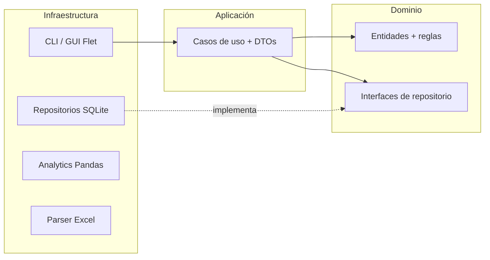
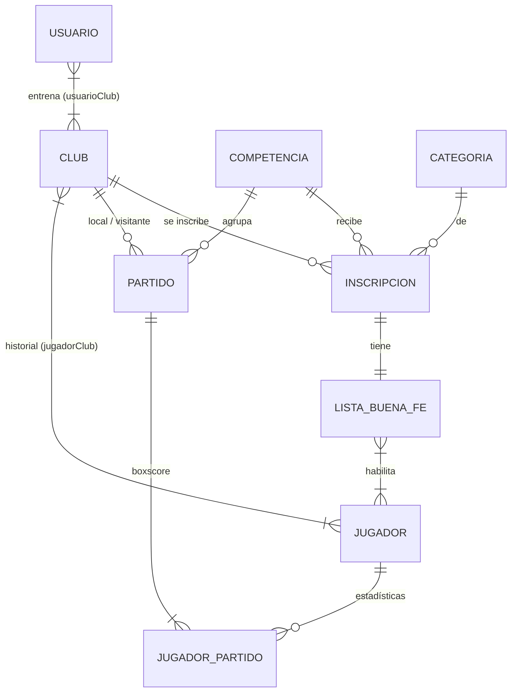

import { Tabs, TabItem, Steps } from '@astrojs/starlight/components';

<Tabs>
<TabItem label="Inicio" icon="information">

:::caution[En desarrollo — Hito 1 (v0.1)]
Stat Pro está en desarrollo. Hoy funciona como CLI: gestión de clubes, jugadores, competencias, inscripciones y listas de buena fe. Estamos implementando la autenticación de usuarios (US-104). Esta wiki se actualiza al cerrar cada versión.
:::

## Qué es

Stat Pro es una aplicación de **estadísticas de básquet para entrenadores (DT)** y analistas, pensada para todo el espectro: categorías formativas (Mini, U13, U15, U17), desarrollo, primera amateur y profesional.

Centraliza el historial de partidos y jugadores en un motor estadístico que funciona **sin internet**, y automatiza la carga a partir de las planillas Excel de **Ges Deportivo**.

## El problema

Encuestamos a entrenadores reales. Estos son los problemas que más se repiten:

| Problema                 | Impacto                                                      | Hoy                   |
| ------------------------ | ------------------------------------------------------------ | --------------------- |
| Carga manual ineficiente | Distrae al DT o requiere una persona dedicada                | Más de 20 min/partido |
| Ceguera estadística      | Decisiones por intuición, sin métricas avanzadas (PPP, EFF)  | 0 % automatizado      |
| Datos fragmentados       | No hay seguimiento histórico ni comparación de rivales       | Papel o Excel         |
| Sin conexión en canchas  | Las apps web fallan en estadios sin señal                    | 100 % online          |
| Plataformas rígidas      | Los datos de Ges Deportivo no se integran sin trabajo manual | Ingesta manual        |

La mayoría de los DTs analiza de forma diferida, en su casa, y está dispuesta a dedicar **menos de 10 a 20 minutos por partido**. Por eso la app prioriza ser **simple y rápida** antes que completa y compleja.

## Qué hace (v1.0)

- **Ingesta multimodal:** importa planillas Excel de Ges Deportivo y permite cargar partidos a mano, jugador por jugador.
- **Persistencia local:** una base SQLite por instalación, 100 % offline.
- **Motor estadístico:** métricas avanzadas (eFG%, EFF, PPP, posesiones, % de rebotes) y tendencias con Pandas.
- **Visualización y reportes:** líderes, gráficos de evolución, comparativas jugador vs. jugador y equipo vs. rival, scouting del rival y exportación a PDF.
- **Multiplataforma:** Windows, Linux, macOS y Android.

**Fuera de alcance de v1.0:** carga en vivo durante el partido, sincronización en la nube y conexión directa con los servidores de Ges Deportivo.

## Métricas de éxito

- Del archivo cargado al informe completo en **menos de 2 minutos**.
- **Más del 95 %** de las estadísticas de un partido generadas sin intervención manual.
- **100 %** de las funciones críticas disponibles sin conexión.

## Roadmap

| Versión  | Hito                     | Contenido                                                                                        | Estado      |
| -------- | ------------------------ | ------------------------------------------------------------------------------------------------ | ----------- |
| **v0.1** | Núcleo de datos y CLI    | Esquema SQLite, repositorios, casos de uso, autenticación, sesión, carga atómica de partidos, CI | 🚧 En curso |
| v0.2     | Ingesta y análisis       | Importación de Excel de Ges Deportivo, métricas avanzadas, migraciones de esquema                | Planificado |
| v0.3     | Visualización y reportes | Dashboards en consola, gráficos de tendencia, PDF, scouting de rivales                           | Planificado |
| v1.0     | Interfaz multiplataforma | GUI con Flet (desktop y mobile), backup, seguridad, binarios distribuibles                       | Planificado |

Más adelante (visión, no compromiso): sincronización en la nube, recomendaciones con IA, carga en vivo con mapa de tiro y una plataforma para federaciones.

## Links

- Repositorio: [https://github.com/Stack-dos/app_estadisticas](https://github.com/Stack-dos/app_estadisticas)
- Instalación, arquitectura y uso: en las pestañas de arriba.

</TabItem>
<TabItem label="Instalación" icon="laptop">

## Requisitos

- Python 3.12 o superior.
- [uv](https://docs.astral.sh/uv/), el gestor de dependencias del proyecto.
- Git.

Funciona en Windows, Linux y macOS. No necesita conexión a internet una vez instalado.

## Pasos

<Steps>

1. Clonar el repositorio:

   ```bash
   git clone https://github.com/Stack-dos/app_estadisticas.git
   cd app_estadisticas
   ```

2. Instalar las dependencias fijadas en `uv.lock`:

   ```bash
   uv sync
   ```

3. Dejar disponible el comando `stats` en la terminal:

   ```bash
   uv tool install --editable .
   ```

4. Verificar que funciona:

   ```bash
   stats --help
   ```

   Tiene que listar los subcomandos (`club`, `jugador`, `competencia`, `partido`…). La base SQLite se crea sola en el primer uso.

</Steps>

Siguiente paso: la pestaña **Uso de la CLI**.

:::note
Los binarios para instalar sin Python (Windows, Linux, macOS y un APK de Android) llegan con la v1.0.
:::

</TabItem>
<TabItem label="Arquitectura" icon="setting">

## Stack

| Pieza           | Tecnología                        | Por qué                                                            |
| --------------- | --------------------------------- | ------------------------------------------------------------------ |
| Persistencia    | SQLite (`sqlite3` de la stdlib)   | Local-first: sin servidor, funciona offline, transacciones ACID    |
| Análisis        | Pandas                            | Fórmulas vectorizadas sobre las vistas SQL                         |
| Interfaz (v0.1) | CLI con `argparse` + `tabulate`   | Validar el núcleo antes de invertir en la GUI                      |
| Interfaz (v1.0) | Flet                              | Python puro para desktop y Android, reusa los casos de uso         |
| Gráficos / PDF  | matplotlib / reportlab            | Sin dependencias de sistema, funcionan offline                     |
| Calidad         | pytest, ruff, mypy `--strict`, uv | Dependencias fijadas con `uv.lock`, mismas versiones en local y CI |

## Capas (Clean + Hexagonal)



- **Dominio** (`src/dominio/`): entidades puras (`@dataclass`) con sus validaciones, excepciones de negocio e **interfaces** de repositorio (`ABC`). No importa `sqlite3`, `pandas` ni ningún framework.
- **Aplicación** (`src/aplicacion/`): un caso de uso por acción del usuario (`RegistrarJugadorUseCase`, `InscribirClubEnCompetenciaUseCase`…), con un único método `ejecutar(dto)`. Recibe los repositorios por constructor (inyección de dependencias).
- **Infraestructura** (`src/infraestructura/`): implementaciones concretas — repositorios SQLite, CLI, motor Pandas, parser Excel, reportes y seguridad. Es la única capa que conoce las librerías externas.

**Regla de dependencias:** `dominio ← aplicación ← infraestructura`. El dominio no conoce a nadie; por eso los casos de uso se testean con repositorios falsos, sin base de datos.

### DTOs

Los casos de uso reciben y devuelven **DTOs** (dataclasses planas, sin lógica). La UI nunca toca entidades de dominio: si cambia una entidad, la CLI no se rompe, y viceversa.

### Composition root

`src/main.py` arma el parser de la CLI y despacha el comando. Cada comando construye las dependencias que necesita (`ejecutar(args, repo=None)`): en producción abre la base real; en los tests se le inyecta un repositorio falso. Los errores de negocio (`ErrorDeDominio`) se atrapan en un único lugar y se muestran como mensaje, sin traceback.

## Modelo de datos



- `jugadorPartido` es la **tabla de hechos** del motor estadístico: más de 20 métricas por jugador y partido (puntos, T1/T2/T3, rebotes, asistencias, recuperos, pérdidas, tapones, faltas, minutos).
- Cuatro **vistas SQL** son el contrato estable que consume Pandas: `v_partidos_resumen`, `v_boxscore_completo`, `v_jugador_totales_temporada` y `v_listas_detalle`. Todas protegen las divisiones por cero.

## Reglas de negocio destacadas

- Email de usuario único; la contraseña nunca se guarda en texto plano (PBKDF2 con _salt_ por usuario en v0.1).
- DNI de jugador único; un jugador no puede tener dos vínculos activos ni períodos superpuestos con clubes.
- Una inscripción es única por club + competencia + categoría, y tiene una única lista de buena fe.
- Solo jugadores habilitados en la lista pueden figurar en un partido oficial.
- Un partido no puede tener el mismo club como local y visitante, y su carga es **atómica**: partido y boxscore se guardan juntos o no se guarda nada.
- Estadísticas coherentes: convertidos ≤ lanzados, valores no negativos y `puntos = T1C + 2·T2C + 3·T3C`.

## Motor estadístico (v0.2)

Funciones puras sobre DataFrames, sin acceso a la base:

| Métrica    | Fórmula                                                      |
| ---------- | ------------------------------------------------------------ |
| eFG%       | `(T2C + 1.5 × T3C) / (T2L + T3L)`                            |
| EFF        | `PTS + REB + AST + REC + TAP − tiros fallados − PERD`        |
| Posesiones | `(T2L + T3L) + 0.44 × T1L + PERD − REB_OF` (estimación FIBA) |
| PPP        | `Puntos / Posesiones`                                        |

Los recortes por partido, competencia, año o carrera completa se resuelven en Pandas sobre las vistas, tanto para jugadores como para clubes.

## Calidad y CI

Cada PR corre en GitHub Actions:

- Auditoría de dependencias (`pip-audit`) y detección de secretos (`gitleaks`).
- `ruff` (lint y formato) y `mypy --strict`.
- Tests en Linux (Python 3.12 a 3.14), Windows y Docker, con cobertura mínima del 85 %.
- Un job agregador (`ci-ok`) que bloquea el merge si algo falla.

## Decisiones de arquitectura

| ADR | Decisión                                                        |
| --- | --------------------------------------------------------------- |
| 001 | Local-first con SQLite                                          |
| 002 | Flet para la GUI (Python puro) en vez de Compose Multiplatform  |
| 003 | Protocolo de ingesta de Excel — _pendiente de un archivo real_  |
| 004 | Versionado del esquema — _pendiente: runner propio vs. Alembic_ |
| 005 | `reportlab` para PDF                                            |
| 006 | PBKDF2 en v0.1; SQLCipher y bcrypt/argon2 en v1.0               |
| 007 | `matplotlib` para gráficos                                      |
| 008 | Backup manual con `VACUUM INTO`                                 |
| 009 | GitHub Actions con runners hosteados                            |

</TabItem>
<TabItem label="Uso de la CLI" icon="seti:shell">

:::note
Mientras Stat Pro esté en v0.1, se usa por línea de comandos. La interfaz gráfica llega en v1.0. Esta sección refleja los comandos disponibles hoy; los marcados con 🚧 están en desarrollo.
:::

Para instalarla, ver la pestaña **Instalación**.

## Flujo típico

<Steps>

1. Crear el club: `stats club add`.
2. Registrar a los jugadores: `stats jugador add`.
3. Vincularlos al club: `stats jugador link`.
4. Crear la competencia y la categoría: `stats competencia add` y `stats categoria add`.
5. Inscribir al club: `stats competencia inscribir`. Se crea su lista de buena fe, vacía.
6. Habilitar a los jugadores en la lista de buena fe: `stats lista add`.
7. Cargar los partidos: `stats partido add` 🚧.

</Steps>

## Comandos

Cada comando tiene su ayuda con `--help`. Los errores de negocio (DNI duplicado, club inexistente, etc.) se muestran como un mensaje claro.

### Usuarios y sesión 🚧

```bash
stats auth register      # crear cuenta de entrenador
stats auth login
stats auth logout
stats club select <id>   # club activo de la sesión
```

### Clubes

```bash
stats club add --nombre "Universitario"
stats club list
```

### Jugadores

```bash
stats jugador add --nombre Juan --apellido Pérez --dni 40111222 --anio 2009
stats jugador link --id-jugador 1 --id-club 1 --fecha-desde 2026-03-01
stats jugador unlink --id-jugador 1 --fecha-hasta 2026-12-31   # para cambiar de club
stats jugador list --id-club 1
```

### Competencias, categorías e inscripciones

```bash
stats categoria add --nombre U15
stats categoria list
stats competencia add --nombre "Liga Provincial" --anio 2026
stats competencia list
stats competencia inscribir --id-club 1 --id-categoria 1 --id-competencia 1 --fecha-presentacion 2026-03-10
stats inscripcion list --id-club 1
```

Al inscribir un club se crea automáticamente su **lista de buena fe**, vacía.

### Lista de buena fe

Solo se puede habilitar a un jugador con vínculo vigente con el club de la inscripción.

```bash
stats lista add --id-inscripcion 1 --id-jugador 1
stats lista remove --id-inscripcion 1 --id-jugador 1
stats lista list --id-inscripcion 1
```

### Partidos

```bash
stats partido list --id-club 1        # con nombres de clubes y competencia
stats partido add                     # 🚧 formulario paso a paso, carga atómica
stats partido boxscore <id_partido>   # 🚧
```

## Próximamente

- **v0.2:** `stats import excel --file planilla.xlsx` para importar partidos de Ges Deportivo, y `stats show`, `stats leaders` y `stats compare` con métricas avanzadas.
- **v0.3:** dashboards en consola, gráficos de evolución y exportación a PDF.

</TabItem>
</Tabs>
