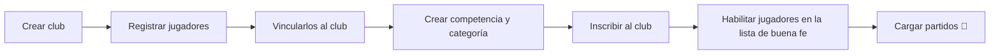

:::note
Mientras Stat Pro esté en v0.1, se usa por línea de comandos. La interfaz gráfica llega en v1.0. Esta página refleja los comandos disponibles hoy; los marcados con 🚧 están en desarrollo.
:::

Para instalarla, ver [Instalación](/porfolio_stack-dos/apps/stat-pro/instalacion/).

## Flujo típico



## Comandos

Cada comando tiene su ayuda con `--help`. Los errores de negocio (DNI duplicado, club inexistente, etc.) se muestran como un mensaje claro.

### Usuarios y sesión 🚧

```bash
stats auth register      # crear cuenta de entrenador
stats auth login
stats auth logout
stats club select <id>   # club activo de la sesión
```

### Clubes

```bash
stats club add --nombre "Universitario"
stats club list
```

### Jugadores

```bash
stats jugador add --nombre Juan --apellido Pérez --dni 40111222 --anio 2009
stats jugador link --id-jugador 1 --id-club 1 --fecha-desde 2026-03-01
stats jugador unlink --id-jugador 1 --fecha-hasta 2026-12-31   # para cambiar de club
stats jugador list --id-club 1
```

### Competencias, categorías e inscripciones

```bash
stats categoria add --nombre U15
stats categoria list
stats competencia add --nombre "Liga Provincial" --anio 2026
stats competencia list
stats competencia inscribir --id-club 1 --id-categoria 1 --id-competencia 1 --fecha-presentacion 2026-03-10
stats inscripcion list --id-club 1
```

Al inscribir un club se crea automáticamente su **lista de buena fe**, vacía.

### Lista de buena fe

Solo se puede habilitar a un jugador con vínculo vigente con el club de la inscripción.

```bash
stats lista add --id-inscripcion 1 --id-jugador 1
stats lista remove --id-inscripcion 1 --id-jugador 1
stats lista list --id-inscripcion 1
```

### Partidos

```bash
stats partido list --id-club 1        # con nombres de clubes y competencia
stats partido add                     # 🚧 formulario paso a paso, carga atómica
stats partido boxscore <id_partido>   # 🚧
```

## Próximamente

- **v0.2:** `stats import excel --file planilla.xlsx` para importar partidos de Ges Deportivo, y `stats show`, `stats leaders` y `stats compare` con métricas avanzadas.
- **v0.3:** dashboards en consola, gráficos de evolución y exportación a PDF.
